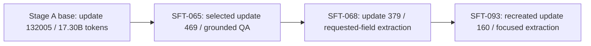
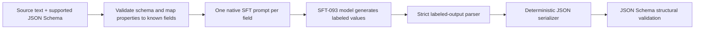

# Historical SFT-093 extraction-plus-assembly release

This is superseded release documentation. The current model adds native JSON SFT; see [current technical report](TECHNICAL_REPORT.md). Historical results below belong to the earlier weights and inference pipeline.

# OpenSML-JSONLite-175M: SFT-093/update 160

## Technical report, training provenance, evaluation and public release specification

**Author/project:** William Zebrowski / OpenSML
**Report date:** October 14, 2026 (America/New_York)
**Artifact:** recreated SFT-093/update 160, retained at the owner's request
The selected weights and standalone inference package are publicly available on [Hugging Face](https://huggingface.co/wzebrowski/OpenSML-JSONLite-175M). No hosted inference endpoint is deployed.

This report describes one exact model and its accompanying inference pipeline. The model is a 175,611,648-parameter decoder pretrained from random initialization, then adapted through grounded QA, requested-field extraction and focused single-field extraction. Its learned output is a labeled list. Software accepts a supported JSON Schema, turns each requested property into an extraction question, strictly parses generated field lines, assembles JSON and validates its structure.

The selected model was **not supervised on raw JSON Schema → JSON answer pairs in its inherited SFT lineage**. The user-visible text-to-JSON functionality belongs to the model **plus** the schema compiler, fieldwise prompt renderer, parser and serializer. Shipping or evaluating only the weights does not reproduce the advertised service.

The recreated checkpoint scores **1,132/1,388 (81.56%)** on the complete observed SNIPS held-out serving panel, versus **953/1,388 (68.66%)** for its parent using the same adapter. It scores **168/196 (85.71%)** on the observed development JSON-extraction panel and **29/40 (72.50%)** on the local playground diagnostic. The latter includes **23/28 observed development examples** and **6/12 newly authored requests**. It still fails the project's strict per-category retention gates. This is a focused extraction candidate, not a demonstrated arbitrary-schema, general web-extraction or production-reliability solution.

All numerical claims below are tied to saved metadata or actual generated outputs. Prepared corpus sizes, the examples actually inherited at selected checkpoints, document-token budgets and inference-only transformations are distinguished explicitly.

## Contents

1. Artifact identity and release description
2. Exact inherited training lineage
3. Architecture and parameterization
4. Tokenizer and serialization
5. Pretraining corpus and curation
6. Pretraining execution, optimization and validation
7. Common supervised objective and precision
8. SFT-065: grounded QA
9. SFT-068: original SNIPS extraction
10. SFT-093: focused extraction and replay
11. Schema-to-JSON inference contract
12. Worked request and API example
13. Evaluation definitions and panels
14. Development, full held-out and playground results
15. Retention failures, limitations and intended use
16. Runtime measurements and dependencies
17. Reproduction and release packaging
18. Dataset notices and release status
19. Artifact/evidence index
20. Appendices: complete field glossary, playground results and metric audit

## 1. Artifact identity and release description

Public source repository: **OpenSML-JSONLite-175M**, https://github.com/williamzebrowskI/OpenSML-JSONLite-175M. The preserved artifact is recreated SFT-093/update 160. This artifact is distinct from OpenSML-150M, the earlier base-only OpenSML-175M documentation and the deleted original SFT-093 trial.

A suitable public description is:

> An English-focused 175.6M-parameter MLX extractor adapted from the OpenSML Stage A base. It extracts exact values for documented field definitions. The included adapter produces schema-validated JSON objects containing arrays of strings, with empty arrays for missing values. It is an experimental extraction pipeline with published failure cases and limited natural-language transfer.

The code's JSON model label selects the playground form; it does not establish direct native JSON supervision. The model retains a `native-sft-chat-v1` user/assistant serialization, despite the deployed task being independent extraction requests rather than conversational chat.

| Identity | Verified value |
| --- | --- |
| Checkpoint bundle | step_0000160_82ffab052730 |
| Local run | pretraining/runs/sft_093_json_approaches_20261014 |
| Local update | 160 |
| Parameters | 175,611,648 |
| Weight representation | BF16 safetensors; no quantization in this artifact |
| Weight file bytes | 351242342 |
| Weight SHA-256 | d552c1380c71c7c0569e9d692ec9c46c5c94bb87a7b024e56df0f0e36df4d798 |
| Training metadata SHA-256 | 32a380899c455449db066ef317de9dd8e80f6977bfb42a6fe03b67c5f23963f8 |
| User-selected preservation | true |
| Automated retention qualification | false |
| Release-ready flag in receipt | false |
| Original deleted diagnostic weight SHA-256 | a001a44290989d65430496617f66abc7f5f3886f26230d7928496f43802ce3a1 |
| Recreation byte-identical to original | false |
| Original diagnostic JSON dev exact | 167/196 |
| Recreated artifact JSON dev exact | 168/196 |

The original trial's weights were deleted under the failed-gate cleanup policy. The owner subsequently requested recreation and preservation. The recreation used a byte-matching training contract, source rows, order and hyperparameters, but produced different weight bytes and slightly different answers. Exact GPU numerical reproducibility is therefore **not established**. The cause of the difference has not been isolated; this report does not assert that a particular kernel caused it.

A public weight release must pin the recreated hash above and use its own scores, rather than attribute the original checkpoint's metrics to it. Optimizer states exist for local continuation but are not required for inference.

## 2. Exact inherited training lineage



Plain-text lineage: `Stage A/132005 → SFT-065/469 → SFT-068/379 → recreated SFT-093/160`.

Only these three SFT stages are inherited. SFT-064 provided a predecessor **data corpus**, not the model weights used to initialize SFT-065. The many failed JSON, QA, extraction and RL experiments are research history, not additional stages embedded in this checkpoint. In particular, SFT-074/077 and trials 080–092 do not initialize SFT-093. SFT-093 starts directly from SFT-068/379.

| Stage | Selected update | Inherited presentations / positions | Inherited serialized tokens | Weight SHA-256 |
| --- | --- | --- | --- | --- |
| Stage A base | 132005 | 17,300,111,360 processed token positions | 17,300,111,360 | 5151567e266244c9e32fd6e01775192633abe227320269ecdefe28ce43e9ccc3 |
| SFT-065 | 469 | 15,008 QA presentations | 3,097,331 | 0991b805a878c15733c909ef7f4127baa2b8866f8ca7d7db232ad39434f80bc4 |
| SFT-068 | 379 | 12,115 extraction presentations | 1,842,593 | 18f0f2b8f57905ac758f392d0eb83e51e508da6a955b9f7991338e690205df86 |
| SFT-093 recreation | 160 | 5,120 presentations / 2,560 source queries | 706,399 | d552c1380c71c7c0569e9d692ec9c46c5c94bb87a7b024e56df0f0e36df4d798 |

The inherited post-training path contains **1,008 optimizer updates**, **32,243 training presentations** and **5,646,323 serialized token positions**. These are not counts of distinct passages: QA contrasts can share a passage, and SFT-093 reuses source queries previously seen by SFT-068. Post-training token accounting includes prompt/header/context positions even though the loss supervises assistant outputs only.

Each SFT stage resets its optimizer and local update/token counters. Model weights continue through the lineage. A public consumer must not mistake `step:160` or `tokens:706399` in the final metadata for the entire lifetime training budget.

## 3. Architecture and parameterization

The same architecture is retained across pretraining and all inherited SFT stages. No new extraction head, adapter or vocabulary was introduced.

| Setting | Value |
| --- | --- |
| Architecture | Causal decoder-only transformer |
| Parameters | 175,611,648 |
| Layers | 24 |
| Hidden size | 768 |
| Query heads | 12 |
| KV heads | 4 |
| Head size | 64 |
| Attention | Grouped-query causal attention |
| Position encoding | RoPE, base 10,000 |
| Normalization | Pre-norm RMSNorm; query/key RMSNorm enabled |
| Feed-forward | SwiGLU |
| FFN hidden size | 2048 |
| Configured MLP ratio / rounding | 4.0 / multiple 256; implementation uses 2/3 sizing |
| Embedding / output projection | Tied weights |
| Projection biases | Disabled |
| Vocabulary | 32000 |
| Context per model call | 2048 |
| Attention implementation | MLX fast attention |
| FFN implementation | Packed Metal SwiGLU |
| Training CE implementation | Metal cross entropy, FP32 reductions |

Implementation evidence: [`model.py`](../provenance/LINEAGE.json), [`precision.py`](../provenance/LINEAGE.json), and the final bundle's `recipe.model` metadata. Weight count and file size are consistent with BF16 parameters plus the safetensors header. GPU allocation readings are not equivalent to file size, total process RSS or system RAM requirements.

The base initialization is recorded as `normal-0.02-residual-scaled-v1`. Earlier OpenSML-150M **weights** were not used to initialize the base; its frozen tokenizer was reused.

## 4. Tokenizer and serialization

The model uses the project's frozen 32K byte-level BPE tokenizer at `reference/opensml-150m/tokenizer/bytebpe32k_v1`. No tokenizer retraining occurs in the inherited SFT stages. Its own manifest has format `sml-v2-tokenizer-v1`; the format name is not a model-weight lineage claim.

| Tokenizer artifact | SHA-256 |
| --- | --- |
| Tokenizer manifest / contract fingerprint | 1194292c6d906ac19e6f01c6ad2b42825143fad426a22aa8856d903776701ecb |
| tokenizer.json | e095f0413a11fa91fbb58f37d00e4c6bcda59beb89b28f6f680db1436a7e8891 |
| tokenizer_config.json | 619f500553367eb76f5be00a98625130ec857b9c367561334984096c029ba2a9 |
| tokenizer corpus.json | e4c47b7b6aba08f948de7c2c7cb94c58dbd09dde2ded6ac185c60856ee686d27 |

Structural token IDs:

| ID | Token | Meaning |
| --- | --- | --- |
| 0 | `<\|pad\|>` | Padding |
| 1 | `<\|doc_end\|>` | Document/end-of-sequence marker |
| 2 | `<\|turn_start\|>` | Role/turn header |
| 3 | `<\|turn_end\|>` | End of a conversational-format turn |

`pretraining/sft/data.py` constructs explicit IDs rather than assuming a generic Hugging Face chat template. A user turn is `turn_start + encode("user\n") + content + turn_end`. An assistant target has the corresponding assistant header, response and turn-end marker; training additionally appends document-end. Generation ends its prompt at the assistant header. User text and role headers are masked from the supervised loss. Assistant content, assistant turn-end and the appended document-end are supervised.

Ordinary text must round-trip through the tokenizer and cannot emit reserved structural IDs. Special-token-looking content can be rejected by the tokenizer; the API does not promise unrestricted literal handling of all structural strings. Prompt/output limits are checked without truncating source text.

## 5. Pretraining corpus and curation

The selected base is the best retained checkpoint at update 132005 after **17,300,111,360 processed token positions**. The original budget was 20B; a continuation was configured toward 30B, but this inherited checkpoint is not a completed 20B or 30B artifact.

Source weights below are intended processed-token sampling weights, not measured unique-document shares. No claim of 17.3B globally unique corpus tokens is made.

| Source | Sampling weight (%) | Repository / configuration | Pinned revision | Additional selection |
| --- | --- | --- | --- | --- |
| FineWeb-Edu | 50 | HuggingFaceTB/smollm-corpus / fineweb-edu-dedup | 3ba9d605774198c5868892d7a8deda78031a781f | Deduplicated educational subset |
| DCLM-Edu | 18 | HuggingFaceTB/dclm-edu | dbad8ad71224482740cd9c9d353591adbf62fe04 | edu_int_score≥3 |
| FineWiki English | 13 | HuggingFaceFW/finewiki / en | 8bd13e72e6a002407649b3e898535f42ceb1aeb9 | English |
| Cosmopedia v2 | 9 | HuggingFaceTB/smollm-corpus / cosmopedia-v2 | 3ba9d605774198c5868892d7a8deda78031a781f | Format contains textbook/tutorial/blog/educational |
| Python text mirror | 10 | Avelina/python-edu-cleaned / default | 3fedf55e02e72dd1fd68963f991f5e91adcb0f8d | int_score≥4 |

Public source cards: [SmolLM corpus](https://huggingface.co/datasets/HuggingFaceTB/smollm-corpus/blob/3ba9d605774198c5868892d7a8deda78031a781f/README.md), [DCLM-Edu](https://huggingface.co/datasets/HuggingFaceTB/dclm-edu/blob/dbad8ad71224482740cd9c9d353591adbf62fe04/README.md), [FineWiki](https://huggingface.co/datasets/HuggingFaceFW/finewiki/blob/8bd13e72e6a002407649b3e898535f42ceb1aeb9/README.md). The Python-Edu upstream subset identifies files; this run used the configured text mirror. The mirror's pinned README could not be retrieved during report preparation, so its provenance statement here comes from the local corpus specification, not a newly completed external audit.

The exact corpus specification is [`configs/corpus_20b.json`](../provenance/LINEAGE.json). Training preserves source text and code indentation. NFC/whitespace normalization is used for identity hashing and partitioning, not to rewrite model input.

The content-split policy hashes identity into 10,000 buckets: 97% training, 1% validation, 1% final and 1% tokenizer development. Identity checks do not establish that a supervised benchmark article never appeared elsewhere in pretraining web data.

Recorded stream settings are a 256-document accepted-document shuffle buffer, bounded 100,000-document deduplication window, 4 prefetched batches and up to 5 retry attempts. The corpus JSON's generic 10,000 shuffle value is not the active stream override. Filtering rejects documents below 200 characters, above 200,000 UTF-8 bytes, with null characters, excess replacement characters or an excessive repeated-line pattern. Source exhaustion fails rather than silently recycling. Deduplication is bounded; it is not global semantic or fuzzy deduplication.

## 6. Pretraining execution, optimization and validation

Pretraining runs on the recorded five-Mac Apple Silicon cluster. Mac1's current local hardware was independently checked during report preparation as an Apple M5 Ultra with 96 GB unified memory. Other worker descriptions below are historical cluster records, not newly queried hardware inventories.

| Mac | Recorded chip | RAM | Microbatch | MLX cache cap |
| --- | --- | --- | --- | --- |
| 1 | M5 Ultra | 96 GB | 7 | 16 GiB |
| 2 | M3 Ultra | 96 GB | 3 | 16 GiB |
| 3 | M4 Max | 36 GB | 2 | 4 GiB |
| 4 | M4 Max | 36 GB | 2 | 4 GiB |
| 5 | M4 Max | 36 GB | 2 | 4 GiB |

The physical ring is 1→2→3→5→4→1. Four accumulation microsteps and 2,048-token sequences produce `(7+3+2+2+2)×4×2048=131072` positions/update. Unequal-rank gradients are weighted by token counts. Early batch transitions mean the lifetime token count is not simply `132005×131072`.

- First 125 updates: microbatches [4, 4, 2, 2, 2], 114,688 positions/update, 14,336,000 tokens.
- From 125: microbatches [6, 4, 2, 2, 2], 131,072 positions/update.
- From 963 / 124,174,336 tokens: [7, 3, 2, 2, 2], same global batch; per-Mac cache caps recorded.
- Stage A continuation starts from 113313 / 14,850,113,536 tokens, retaining weights, FP32 optimizer state, source cursors, counters and controller history.
- Selected base: 132005 / 17,300,111,360 tokens.

Ethernet supports SSH orchestration; the training ring uses verified Thunderbolt/RDMA links. Sequential microbatch materialization, FP32 gradient accumulation and custom Metal paths were used. Public documentation must not include private SSH identities, addresses, access credentials or machine serial numbers.

| Pretraining optimizer/schedule | Recorded setting |
| --- | --- |
| Optimizer | AdamW |
| Nominal peak LR | 3e-4 |
| Original warmup | 200M tokens, 1% of the 20B budget |
| Base schedule | Warmup/stable interval/cosine; continuation stretches nominal decay to 24B–30B |
| Adaptive controller | Factor 0.8; patience 12 evaluations; cooldown 10; minimum delta 0.002 |
| Controller LR floor | 3e-5 |
| Effective cap at selected 132005 | 3.221225472e-5 |
| Recorded controller reductions / evaluations | 9 / 242 |
| Betas | (0.9,0.95) |
| Epsilon | 1e-8 |
| Weight decay | 0.1 |
| Gradient clipping | 1.0 |
| Seed | 7337 |
| Loss | Next-token cross entropy; FP32 reductions |

The nominal 3e-4 schedule is not the effective late-run learning rate: the retained controller cap bounds it. The record does not justify a claim that the run trained at 3e-4 for all 17.3B positions.

Validation and qualitative samples occur at 50M-token boundaries. The fixed validation panel has 32 batches/source, batch 2, five sources, context 2,048: nominally 655,360 positions/event. Aggregate loss is source-mixture weighted. Validation fingerprint: `4ddd461c131d4d27d07bb07f5aab3fcb5a00d4b1202066e3d9b6ee6b3129087b`. Selected-base validation loss is **2.5563359551876785**, perplexity **12.8885**. This measures document prediction, not extraction or chat reliability.

Regular saves occur every 100M tokens, plus best-validation and clean-stop saves. Exact checkpoint metadata is authoritative. The initial October 2 technical report's early observations, 20B target and old schedule describe history; they are superseded here for this selected artifact. Contemporary qualitative logs often showed roughly 41k tokens/s, but no reproducible end-to-end cluster performance/energy benchmark is established by this report. The separate 42.7k profiling candidate is not claimed as the configuration that trained this checkpoint.

### Training run

The 175.6M-parameter base was trained from random initialization using next-token prediction across the educational web, Wikipedia, Cosmopedia and Python mixture. Five Apple Silicon Macs carried out distributed pretraining over Thunderbolt/RDMA. Validation was measured every 50M tokens. The curves show a steep early loss reduction followed by slower improvement; the published base was selected using held-out validation.


*Training loss and held-out validation during pretraining. Left: raw training loss and exponential moving average. Right: held-out validation loss.*

## 7. Common supervised objective and precision

All inherited SFT stages run locally on Mac1 and update all 175,611,648 parameters. No LoRA/adapters, added span head, frozen-layer adaptation, reward model, DPO, PPO or GRPO is part of this lineage.

The model computes in BF16. `MasterAdamW` keeps FP32 master parameters and optimizer moments; small optimizer changes are applied to the master copy before recasting compute weights. Parameters with fewer than two dimensions do not receive decoupled weight decay. Gradient contributions are accumulated in FP32, averaged by actual conversation count, checked for finiteness and globally clipped.

For record `i`, the supervised response loss is the mean CE over its assistant/EOS positions:

`L_i = sum_t(mask_it × CE(logits_it, target_it)) / max(1, sum_t mask_it)`

The optimizer minimizes the batch mean of record losses. This gives equal record weight, not equal weight per output token across the whole batch. Loss does not supervise user prompt tokens. Two-record microbatches use padding to multiples of 128 under the recorded policy. Padding labels are ignored.

Each stage uses a fresh optimizer. The low LR and replay reduce adaptation pressure but do not guarantee nonregression. All quality decisions depend on generated outputs, not just teacher-forced loss.

| Setting | SFT-065 | SFT-068 | SFT-093 |
| --- | --- | --- | --- |
| Batch / microbatch | 32 / 2 | 32 / 2 | 32 / 2 |
| Planned updates | 782 | 379 | 160 |
| Inherited selected update | 469 | 379 | 160 |
| Peak LR | 1e-5 | 5e-6 | 5e-6 |
| Final LR at planned end | 2e-6 | 1e-6 | 1e-6 |
| Warmup updates | 20 | 20 | 12 |
| Decay | Cosine | Cosine | Cosine |
| Betas | (0.9,0.95) | (0.9,0.95) | (0.9,0.95) |
| Epsilon | 1e-8 | 1e-8 | 1e-8 |
| Weight decay | 0.01 | 0.01 | 0.01 |
| Gradient clip | 1.0 | 1.0 | 1.0 |
| Seed | 20261013 | 20261013 | 20261014 |
| DEV checkpoints | 0,156,313,469,625,782 | 0,100,200,300,379 | 0,80,160 |

The LR shown for SFT-065's planned end applies at 782; selecting 469 inherits a mid-decay checkpoint, not the final 2e-6 endpoint. Script source and metadata encode the exact schedule.

## 8. SFT-065: grounded QA

Parent: Stage A/132005. The prepared 25,000-record corpus contains 17,000 original published QA rows and 8,000 controlled fictional rows. Source totals: 16,624 SQuAD 2.0, 376 Dolly closed QA, 3,000 calibration, 3,000 multipart and 2,000 corrections. Natural and contrasting buckets overlap source type, not record membership.

SQuAD 2.0 supplies passage-grounded answerable/unanswerable questions; Dolly supplies selected closed QA. See the original [SQuAD source](https://rajpurkar.github.io/SQuAD-explorer/) and [Dolly dataset card](https://huggingface.co/datasets/databricks/databricks-dolly-15k). The local SQuAD training snapshot SHA is `68dcfbb971bd3e96d5b46c7177b16c1a4e7d4bdef19fb204502738552dede002`. Dolly revision is `bdd27f4d94b9c1f951818a7da7fd7aeea5dbff1a`, JSONL SHA `2df9083338b4abd6bceb5635764dab5d833b393b55759dffb0959b6fcbf794ec`.

Public answers are retained rather than rewritten by a teacher model. SQuAD offsets are checked against passages. Eligibility limits include 30–450 passage words, packed sequence ≤ 1,024 and answer ≤ 150 tokens. Article/group/document partitioning excludes known cross-split duplicates. Controlled facts and target logic are programmatically reconstructed; this is not independent human validation of all generated phrasing. Controlled frame IDs and source groups are separated across splits, while structural task families remain shared.

The prompt asks for a direct answer using only the passage and exactly `Not stated.` when unsupported. Contrast records ask different questions about the same passage. Calibration, multipart and correction records teach answerability, completeness and revision of facts. No JSON output targets are added.

| Bucket | Prepared records | Actually inherited by 469 |
| --- | --- | --- |
| Natural QA | 12000 | 7226 |
| Contrasting QA | 5000 | 2997 |
| Calibration / missing evidence | 3000 | 1797 |
| Multipart | 3000 | 1812 |
| Corrections | 2000 | 1176 |
| Total | 25000 | 15008 |

Inherited source counts are 10,008 SQuAD 2.0, 215 Dolly, 1,797 calibration, 1,812 multipart and 1,176 corrections, reconstructed from the saved permutation seed and first 469 batches. The full run finished 782 updates / 25,000 records / 5,161,605 tokens. The selected 469 bundle contains 15,008 records / 3,097,331 tokens; later updates are not inherited.

Development: 136 requests; local test: 272. Selected SFT-065/469 test exact 89/272 (32.72%), token F1 55.27%, answerable 71/224 and absent 18/48. These are local curated panels, not official full SQuAD or conversational leaderboards. This stage is a working QA parent, not a claim of strong general chat quality.

## 9. SFT-068: original SNIPS extraction

Parent: SFT-065/469. Source: [SNIPS NLU benchmark, June 2017 custom-intent data](https://github.com/sonos/nlu-benchmark/tree/b86ac7f1577868c42158d0dec77db50956046696/2017-06-custom-intent-engines), pinned revision `b86ac7f1577868c42158d0dec77db50956046696`.

Original chunk annotations are reconstructed into exact text spans and requested-field mappings. Raw source counts are 13,784 training and 700 validation queries. Recorded exclusions include 197 duplicate training entries, 5 duplicate test entries, 3 conflicting-text groups, 8 official-test overlaps removed from training and 147 unsupported-text entries. The PlayMusic training source uses Latin-1 decoding; other selected sources use UTF-8, with no silent replacement.

After grouping case/whitespace-equivalent text and excluding conflicting annotations, 10% of remaining full-training groups are reserved. 14 groups/category form the compact 196-request DEV panel, each with two genuinely different requested-field views. Unused reserved groups stay excluded. The original validate files yield 694 test sources × 2 views = 1,388 requests. Final splits have 12,115 distinct TRAIN texts, 98 DEV texts and 694 test texts.

Seven categories: AddToPlaylist, BookRestaurant, GetWeather, PlayMusic, RateBook, SearchCreativeWork, SearchScreeningEvent. Gold values are exact chunks, trimmed only at outer whitespace. Date/number normalization is not performed. Each source gets a varied field subset, field order and missing-field conditions. Multiple values are repeated field lines in source order; absence is `field: NOT_STATED`.

The model sees field names and definitions, not JSON Schema. This is annotation agreement on short requests, not proof that all SNIPS categories/playlist/type conventions perfectly match production semantics. Unannotated slots are treated as absent; missing-annotation agreement is not independent semantic certification.

The single pass completes 379 updates / 12,115 records / 1,842,593 tokens. DEV selection prioritizes category-macro exact extraction, then field accuracy, F1, pairs, unsupported values and NLL. The selected update 379 parent's original **joint labeled protocol** test scores 1,159/1,388 (83.50%) whole-request exact, 3,071/3,347 (91.75%) field accuracy, value F1 90.84%, present 1,705/1,879 (90.74%) and missing 1,366/1,468 (93.05%). This original labeled test result must not be conflated with its different fieldwise JSON-serving baseline later in this report.

## 10. SFT-093: focused extraction and replay

Parent: SFT-068/379. The bank builder checked 2,165 original TRAIN requests with that parent and accepted 1,920 where its generated labeled answer matched the requested gold. Selection is approximately balanced across seven categories. This bank filter uses only TRAIN predictions; it is an easy-example bias, not proof of general correctness. Original source rows are recovered by ID rather than retaining report-added source labels.

An additional 640 SNIPS TRAIN queries outside the bank are selected by a deterministic hash order. These queries are new to the SFT-093 pool, not unseen by SFT-068, which already trained on the full 12,115-query set. No authored playground cases, DEV answers, test answers or earlier JSON outputs are included as training targets.

Each of 2,560 sources provides an unchanged original labeled replay and one focused single-field view, totaling 5,120 presentations. For the focused view, the deterministic selector alternates preference for an absent field when one exists, otherwise choosing a present field; it never invents absence outside the original requested-field mapping. The resulting focused pool contains 1,900 present-field and 660 absent-field requests. There is no claim of an exactly 50/50 presence balance.

Each 160-update batch contains 16 replay + 16 focused records; each presentation is visited once, under a fixed permutation. The same source can consequently appear twice in different views. The final packed corpus maximum sequence length is 230 tokens. Values and span boundaries are checked back against pinned original chunks; target decoding round-trips to exact expected mappings. Input/output masks and source-disjoint TRAIN/DEV/test identities are checked before training.

The data manifest records demonstration IDs for other representation trials, but SFT-093 **does not use demonstrations or few-shot prompts**. Its training contains labeled outputs only. The 160-update recreation processes 5,120 records and 706,399 serialized tokens. Numeric finite-gradient checks and a disposable miniature-model update/checkpoint roundtrip passed before the original loop; these validate mechanics, not quality or cross-run GPU bit reproducibility.

The original SFT-093/160 reached 167/196 but failed retention and was deleted. The user requested this variant again. The recreation matched the original contract but now scores 168/196 and is retained as a user-selected diagnostic. Its eligibility flags remain false; retention criteria were not changed to manufacture a pass.

### 10.1 Exact examples of the supervised representations

The following examples are actual retained training rows. They illustrate learned tasks, not model predictions. The QA example is among the 15,008 presentations inherited through SFT-065/469. The SNIPS replay is an original requested-field view inherited by SFT-068 and replayed in SFT-093; the focused view uses the same source with only one requested field.

**Grounded QA, SFT-065** — row `qa065:controlled:train:calibration:1485:present`:

```text
USER
Answer the question using only the passage. Give a direct answer without adding unsupported information. If the passage does not contain the answer, reply exactly: Not stated.

Passage:
Fictional exhibition entry notes, reference T-C-01485. The exhibition entry for Luca Vale lists artwork: Red Garden; gallery: Ash Gallery. The exhibition entry for Boris Turner lists artwork: Golden Field; gallery: Cedar Gallery. These notes describe separate entries; do not transfer details between people.

Question: What is the gallery for Luca Vale?

ASSISTANT TARGET
The gallery for Luca Vale is Ash Gallery.
```

**SNIPS replay, SFT-068 and SFT-093** — row `snips:PlayMusic:train:1295:view0`:

```text
USER
Read the request below and copy the values for the listed fields. Copy each value exactly, preserving spelling and case. Do not normalize numbers or dates. Output one field: value line per value, in requested-field order and source order within a field. If the text does not supply a requested field, output field: NOT_STATED. Do not add explanations.

Requested fields:
- track: track name
- music_item: word specifying the requested music category, such as artist, track, song, or album

Text:
play the track Asleep In The Deep

ASSISTANT TARGET
track: Asleep In The Deep
music_item: track
```

**Focused extraction, SFT-093** — same row, target view:

```text
USER
Extract only the requested fields from the text. Copy each value exactly, preserving spelling and case. Do not normalize numbers or dates. Output one field: value line per value, in requested-field order and source order within a field. If the text does not supply a requested field, output field: NOT_STATED. Do not add explanations.

Requested fields:
- track: track name

Text:
play the track Asleep In The Deep

ASSISTANT TARGET
track: Asleep In The Deep
```

For an absent field, the extraction target uses `field: NOT_STATED`; the adapter later turns that into an empty JSON array. Neither of these extraction targets contains JSON syntax or a JSON Schema. The source span `[15,33)` for the example track is indexed into the original text during corpus verification; those offsets are not supplied as this model's training answer.

## 11. Schema-to-JSON inference contract



The serving adapter is [`json_fieldwise_playground.py`](../provenance/LINEAGE.json). The model remains a causal generator; a separate decoder cache is created for each independent field call. No previous field output or chat history is supplied as evidence to the next field. A request for `k` properties makes `k` model calls. The model never receives the fixture reference answer.

Supported schema boundary:

- Object root, 1–8 properties; every property required; `additionalProperties:false`.
- Each value is an array with exactly `items:{"type":"string"}`. Missing values are `[]`.
- Known canonical field names use the frozen glossary. An optional supplied description must match that trained definition exactly.
- A custom output-key alias is supported only when its description uniquely matches one glossary entry. Software maps it to a canonical extraction field and remaps the output key. This is not learned arbitrary-schema interpretation.
- Different properties cannot request the same semantic definition under multiple keys.
- Draft 2020-12 is the accepted explicit `$schema`; it may also be omitted. Titles/descriptions are annotations, not factual source evidence.
- Unsupported scalar/null/nested types, enums, format constraints, min/max constraints, conditional schemas, references and arbitrary new definitions are rejected.
- The instruction is fixed to the exact-span policy shown in the playground. Changed instructions are rejected rather than silently ignored.
- Source text must fit each native prompt plus requested output budget in 2,048 tokens. No truncation. API character ceilings do not replace the token-budget check.

The canonical instruction is:

```text
Copy exact values for each requested field, preserving case and source order. Use [] when a field is not stated.
```

The native field prompt additionally specifies no number/date normalization, one `field: value` line per value, source order and `field: NOT_STATED` for absence. The model receives those names/definitions and source text, not the full JSON Schema document.

Strict parsing requires a recognized requested field and nonempty value. Missing required fields, extra fields, duplicate empty declarations or an empty/value contradiction fail the representation. There is no fuzzy correction, automatic field filling or dropping of unsupported values. A syntactically valid array can still contain a hallucinated country, wrong entity or incomplete list. Schema validation checks structure, not whether values are grounded.

The literal `NOT_STATED` is reserved by the labeled protocol; it is not a lossless representation of an entity genuinely named that string. Multiline values and unrestricted complex paragraphs are outside the validated target format. Unicode/case/spelling are preserved by the tokenizer and parser, but multilingual extraction has not been evaluated.

## 12. Worked request and API example

Actual newly authored playground case FIELD-29:

```text
Play the track Blue Lantern by Mira Sol.
```

```json
{
  "type": "object",
  "properties": {
    "track": {"type": "array", "items": {"type": "string"}, "description": "track name"},
    "artist": {"type": "array", "items": {"type": "string"}, "description": "performer or musical artist"},
    "album": {"type": "array", "items": {"type": "string"}, "description": "album name"}
  },
  "required": ["track", "artist", "album"],
  "additionalProperties": false
}
```

Three separate model outputs are parsed as `track: Blue Lantern`, `artist: Mira Sol`, and `album: NOT_STATED`. The actual final result matches:

```json
{"track":["Blue Lantern"],"artist":["Mira Sol"],"album":[]}
```

Historical workspace server command, run from the original research workspace root (not a launch command for this dedicated repository):

```bash
PYTHONPATH=pretraining:pretraining/scripts:pretraining/data/json_sft_validator_20261010 \
  .venv/bin/python -u pretraining/scripts/start_json_playground.py --port 8767
```

This entry point currently reads local registration/evaluation receipts. It is a verified workspace command, not yet a standalone portable public-release loader. Public packaging must replace workspace-specific receipt resolution with a relative release manifest and package the required implementation.

Example HTTP client against that running local service:

```python
import json
import urllib.request

schema = {
    "type": "object",
    "properties": {
        "artist": {"type": "array", "items": {"type": "string"},
                   "description": "performer or musical artist"},
        "album": {"type": "array", "items": {"type": "string"},
                  "description": "album name"},
    },
    "required": ["artist", "album"],
    "additionalProperties": False,
}
body = {
    "model_id": "sft-093",
    "document": "Play songs by Mira Sol.",
    "schema_text": json.dumps(schema),
    "instruction": "Copy exact values for each requested field, preserving case and source order. Use [] when a field is not stated.",
    "constrained": True,
    "max_tokens": 160,
    "temperature": 0,
    "repetition_penalty": 1,
    "top_k": 40,
    "seed": 2026,
}
request = urllib.request.Request(
    "http://127.0.0.1:8767/api/json/generate",
    data=json.dumps(body).encode(),
    headers={"Content-Type": "application/json"},
)
with urllib.request.urlopen(request, timeout=60) as response:
    for line in response:
        if line.startswith(b"data: "):
            event = json.loads(line[6:])
            if event["type"] == "error":
                raise RuntimeError(event["message"])
            if event["type"] == "done":
                if not event["success"]:
                    raise RuntimeError("Extraction did not complete validly")
                print(event["value"])
```

The endpoint streams server-sent events, not one ordinary JSON HTTP response. `success:true` means schema-valid structure and natural completion; it does not certify extraction correctness. The fieldwise route assembles JSON regardless of the legacy `constrained` flag; it reports `constrained:false` and `output_mode:fieldwise-assembly` because it does not apply a JSON grammar to model tokens. The UI disables that legacy switch for this route and labels assembly accurately.

Sampling defaults match evaluation: temperature 0, repetition penalty 1, maximum 160 tokens per field. Nondefault temperature/penalty/top-k/seed options are honored by native-token sampling; scores in this report do not cover those nondefault settings. Total generated tokens can exceed 160 across multiple field calls.

Pydantic is optional caller-side schema tooling; no Pydantic class is given to the neural network. `model_json_schema()` output works only if it falls within the supported contract. For example, use `extra="forbid"`, required `list[str]` fields and exact glossary descriptions; scalar defaults or additional constraints are unsupported.

## 13. Evaluation definitions and panels

All main extraction scores use generated answers with temperature 0, repetition penalty 1, 160 tokens/call, native serialization and no prompt truncation. Object-key order is ignored for exact correctness; array order, case, spelling, duplicates and required keys are significant. Every call must terminate naturally. No model sees the expected answer at inference.

Metrics:

- **Complete-request exact:** final parsed/schema-valid object equals the entire expected mapping and all field calls finish naturally.
- **Field accuracy:** count of exactly correct field-value lists divided by requested fields, including missing fields.
- **Value precision/recall/F1:** multiset counts of `(field,value)` pairs; duplicates affect counts. `precision=TP/(TP+FP)`, `recall=TP/(TP+FN)` and their harmonic mean, F1. Expected-value count can differ from present-field count when a field has multiple values.
- **Present accuracy:** exactly correct nonempty expected field lists divided by present fields.
- **Missing accuracy:** exactly correct empty expected field lists divided by annotated absent fields.
- **False abstention:** a present field predicted as an empty list. **Missed abstention:** an absent field not predicted empty.
- **Unsupported values:** predicted strings absent anywhere in the source text. This substring test does not detect every boundary error or wrong association and is not a general hallucination-rate measure.
- **Paired correctness:** both requested-field views of the same source are completely correct. Individual request observations within a pair are correlated.
- **Format/parse/schema validity, natural stop, token limits, nonempty/nonrepetitive output, requested order:** separate diagnostics. Valid JSON does not establish correct extraction.
- **Output NLL:** teacher-forced mean response CE. Development NLL is averaged across the fieldwise subrequests. It is representation-dependent and cannot be compared casually with another output format or used as correctness.

Compact DEV coverage is 196 JSON requests from 98 sources/7 categories, 196 original labeled requests, 136 QA controls and 32 in-sample FIT requests. The 32 FIT requests are chosen lexicographically from training IDs and are **all AddToPlaylist**, so they are not a balanced full-training acquisition test. FIT passes at ≥ 29/32 exact and 32/32 schema validity.

The full serving test below contains 1,388 requests / 694 source pairs, using the original SNIPS held-out panel with a schema compiled from each request's fields. These requests have been evaluated in earlier research; neither this nor DEV is a fresh blind benchmark. Results measure annotation agreement in this modified requested-field task, not the official SNIPS intent-classification protocol.

The 40 playground cases contain 28 observed DEV views plus 12 newly authored requests. These are a small diagnostic, not an external certified benchmark. Golds remain in the browser/scorer; API requests include only text, schema, instruction and generation options. All 28 observed live outputs match the recreated saved DEV outputs exactly. Nonempty/nonrepetitive checks are heuristics, not human fluency ratings.

## 14. Verified results

### 14.1 Same-route development comparison

| Metric | Parent SFT-068/379 fieldwise baseline | Recreated SFT-093/160 |
| --- | --- | --- |
| Whole request exact | 70.92% | 85.71% |
| Field accuracy | 85.90% | 93.38% |
| Value precision | 81.06% | 91.03% |
| Value recall | 93.88% | 94.96% |
| Value F1 | 87.00% | 92.96% |
| Present-field accuracy | 93.86% | 94.95% |
| Missing-field accuracy | 74.35% | 91.10% |
| Schema-valid rate | 100.00% | 100.00% |
| Completely correct requests | 139 | 168 |
| Correct fields | 402 | 437 |
| Correct present fields | 260 | 263 |
| Correct missing fields | 142 | 174 |
| TP values | 261 | 264 |
| FP values | 61 | 26 |
| FN values | 17 | 14 |
| False abstentions | 4 | 4 |
| Missed abstentions | 49 | 17 |
| Unsupported values | 9 | 1 |
| Predicted values | 322 | 290 |
| Natural completion | 196 | 196 |
| Token-limit failures | 0 | 0 |
| Nonempty/nonrepetitive | 196 | 196 |
| Requested-field order | 196 | 196 |
| Output NLL | 0.044543960131912703 | 0.02902049323023008 |
| Both views correct /98 | 50/98 | 73/98 |

The gain is 29 additional correct requests, or 14.80 percentage points. Much of it is improved missing-field handling: 174/191 correct versus 142/191. DEV errors still include 28 incomplete/incorrect requests, 26 false-positive values, 14 missed values and one source-unsupported value. The original deleted SFT-093 had 167 correct requests, 436 correct fields and 173 correct missing fields; its full metric record is separate from this recreation.

### 14.2 Recreated development category results

| Category | Requests correct | Field accuracy | Precision | Recall | F1 | Present | Missing | NLL |
| --- | --- | --- | --- | --- | --- | --- | --- | --- |
| AddToPlaylist | 21/28 | 88.73% | 90.00% | 90.00% | 90.00% | 90.00% | 87.10% | 0.061795 |
| BookRestaurant | 21/28 | 89.04% | 83.33% | 95.24% | 88.89% | 95.24% | 80.65% | 0.055806 |
| GetWeather | 22/28 | 90.00% | 86.36% | 92.68% | 89.41% | 92.50% | 86.67% | 0.041639 |
| PlayMusic | 27/28 | 98.57% | 97.37% | 100.00% | 98.67% | 100.00% | 96.97% | 0.011644 |
| RateBook | 25/28 | 95.95% | 93.02% | 93.02% | 93.02% | 93.02% | 100.00% | 0.018461 |
| SearchCreativeWork | 28/28 | 100.00% | 100.00% | 100.00% | 100.00% | 100.00% | 100.00% | 0.002719 |
| SearchScreeningEvent | 24/28 | 94.37% | 90.48% | 95.00% | 92.68% | 95.00% | 93.55% | 0.011079 |

### 14.3 Full observed held-out serving comparison

| Metric | Parent SFT-068/379, same fieldwise adapter | Recreated SFT-093/160, same fieldwise adapter |
| --- | --- | --- |
| Whole request exact | 68.66% | 81.56% |
| Field accuracy | 83.54% | 91.04% |
| Value precision | 77.05% | 88.64% |
| Value recall | 93.61% | 92.60% |
| Value F1 | 84.53% | 90.58% |
| Present-field accuracy | 93.61% | 92.60% |
| Missing-field accuracy | 70.64% | 89.03% |
| Schema-valid rate | 99.71% | 99.78% |
| Completely correct requests | 953 | 1132 |
| Correct fields | 2796 | 3047 |
| Correct present fields | 1759 | 1740 |
| Correct missing fields | 1037 | 1307 |
| TP values | 1759 | 1740 |
| FP values | 524 | 223 |
| FN values | 120 | 139 |
| False abstentions | 18 | 69 |
| Missed abstentions | 431 | 161 |
| Unsupported values | 43 | 5 |
| Predicted values | 2283 | 1963 |
| Natural completion | 1388 | 1388 |
| Token-limit failures | 0 | 0 |
| Nonempty/nonrepetitive | 1388 | 1388 |
| Requested-field order | 1384 | 1385 |
| Both views correct / 694 | 360/694 | 498/694 |

| Category | Requests | Parent exact | Recreated exact | Recreated field accuracy | Recreated F1 | Recreated missing accuracy |
| --- | --- | --- | --- | --- | --- | --- |
| AddToPlaylist | 198 | 148/198 (74.75%) | 164/198 (82.83%) | 91.54% | 90.81% | 90.43% |
| BookRestaurant | 200 | 122/200 (61.00%) | 151/200 (75.50%) | 89.87% | 88.34% | 89.75% |
| GetWeather | 198 | 101/198 (51.01%) | 143/198 (72.22%) | 87.43% | 86.93% | 80.67% |
| PlayMusic | 200 | 97/200 (48.50%) | 139/200 (69.50%) | 84.17% | 83.33% | 83.33% |
| RateBook | 196 | 176/196 (89.80%) | 183/196 (93.37%) | 97.41% | 97.23% | 97.03% |
| SearchCreativeWork | 200 | 189/200 (94.50%) | 192/200 (96.00%) | 97.08% | 96.62% | 100.00% |
| SearchScreeningEvent | 196 | 120/196 (61.22%) | 160/196 (81.63%) | 92.10% | 90.76% | 91.56% |

The recreated model gains **179 completely correct requests**, or **12.90 percentage points**, through the same fieldwise adapter. Whole-request exact improves in all seven categories. Missing-field correctness rises from 1,037/1,468 to 1,307/1,468, and unsupported predicted values fall from 43 to 5. There is also a measurable tradeoff: present-field correctness falls from 1,759/1,879 to 1,740/1,879; value recall declines from 93.61% to 92.60%, and false abstentions rise from 18 to 69. Aggregate improvement is therefore not equivalent to improvement on every metric.

The comparison ran through the live local SSE endpoint, model by model, with 1,388 outputs each and identical inputs/decoding. Three candidate requests and four parent requests failed strict parsing/schema completion; both models otherwise terminated naturally without token-limit failures. Output NLL was **not measured** in this serving test. The parent's original 83.50% joint-labeled score uses a different protocol. This comparison does not select an update, alter earlier retention gates or remove the failures on newly authored examples.

### 14.4 In-sample fit, original labeled extraction and QA controls

| Panel | Exact | Other metrics |
| --- | --- | --- |
| TRAIN FIT 32 | 31/32 | Field 98.75%; F1 99.16%; NLL 0.008541; all 32 schema valid |
| Original labeled 196 | 164/196 | Field 92.09%; F1 91.98%; present 92.78%; missing 91.10% |
| QA 136 | 34/136 | Token F1 47.98%; NLL 0.598362; answerable 33/112; missing 1/24 |
| Paired original labeled | 71/98 | Both requested views correct |
| Paired QA | 10/48 | Both answers exact; same answer on 7/48 pairs |

| QA category | Exact | Token F1 |
| --- | --- | --- |
| calibration | 0/16 | 25.82% |
| corrections | 0/16 | 55.65% |
| dolly_closed_qa | 0/8 | 27.98% |
| multipart | 2/16 | 53.13% |
| squad2 | 32/80 | 51.84% |

The QA panel has 3 false abstentions, 23 missed abstentions, 4 wrong-value mentions and 8 complete-requested-values passes, versus 10 at baseline. Exact-normalized QA and conservative controlled-equivalence checks are not human semantic evaluations; an unrecognized paraphrase does not prove that every part of an answer is wrong. These panels show weak general QA and do not support marketing this model as a strong chatbot. ARC, PIQA, HellaSwag or IFEval scores from unrelated SFT checkpoints are not attributed to this artifact.

### 14.5 Local playground diagnostic

| Subset | Correct | Accuracy |
| --- | --- | --- |
| Observed 28 DEV examples | 23/28 | 82.14% |
| New 12 authored requests | 6/12 | 50.00% |
| Total | 29/40 | 72.50% |

The new cases expose practical failures despite valid JSON:

- `What is the weather in Oslo on Friday?` produced `country:["Norway"]`, although no country was supplied. The model inferred plausible world knowledge rather than copied evidence.
- `Play songs by Mira Sol and Theo Lane.` produced only Mira Sol, omitting the second performer.
- `Give me the weather in Bergen and Oslo.` omitted Oslo and inferred Norway.
- A book rating of four out of five stars missed the maximum-rating field.
- A Thai restaurant request missed the cuisine.
- An album request also filled a missing track with the album title.

Reference answers and actual outputs for all 40 cases are listed in Appendix B. Most newly authored requests are still short; these failures do not require long-document complexity. No claim of reliable paragraph extraction, record binding or arbitrary schema inference follows from 85.71% DEV exact.

## 15. Retention failures, limitations and intended use

Predeclared gates compare every category's counts, pair correctness and error ceilings with the parent, requiring improvements not to conceal local regressions. Recreated SFT-093 fails `json_content_floor`, `json_vs_start`, `labeled_retention` and `qa_retention` ; TRAIN FIT passes. The criteria are strict, finite-panel checks, not a statistical guarantee of unseen nonregression.

Concrete recreated DEV regressions include a lost present-field/screening-event result, additional weather false-positive value relative to the original labeled parent, playlist/music labeled-extraction losses and a lost multipart QA answer. Complete requested values in QA decline 10→8. Aggregate gains coexist with those category losses. The owner explicitly chose preservation/deployment exploration despite these flags; the report does not rename that decision an automated acceptance.

Appropriate exploratory use is constrained-domain extraction of named values from short English requests with documented fields, source-preserving strings and an explicit empty-list policy. Consumers should evaluate their own target domain and treat `success:true` as structural completion rather than factual certification.

Unsupported or unestablished capabilities include arbitrary new field definitions, nested records, typed scalar conversion, date/number normalization, complete multi-entity lists, correction/current-value reasoning, owner/entity associations, long web pages, robust prompt-injection resistance, multilingual quality, perfect source grounding and general conversation. The current instruction renderer is not a demonstrated security boundary. No general human accuracy, safety or privacy audit is claimed.

There is no measured calibration score for extraction confidence. A softmax probability, low NLL or valid JSON must not be presented as a calibrated confidence in correct extraction. Structured success is particularly easy to achieve because software owns the JSON syntax.

## 16. Runtime measurements and dependencies

Training/recreation and the local test used Mac1: Apple M5 Ultra, 96 GB unified memory. The measured 40-case playground diagnostic made 101 model calls. Defaults were greedy decoding, repetition penalty 1 and 160 tokens per field; cases used 1–4 fields. The service's internal generation timer starts after validation and model loading and ends after field generation/assembly. It excludes full HTTP client latency, cold weight loading and separate tokenizer/schema preparation.

| Small diagnostic measurement | Value |
| --- | --- |
| Minimum generation timer | 33.51 ms |
| Median generation timer | 83.05 ms |
| 95th percentile generation timer | 130.49 ms |
| Maximum generation timer | 147.48 ms |
| Largest reported MLX peak allocation | 0.4270 GiB |
| Model calls across 40 requests | 101 |

These are small, observed measurements with a warm service. They do not establish a deployment SLA, concurrency throughput, CPU performance, total process RSS or performance on other GPUs. The MLX peak allocation is cumulative since the model loader resets its peak counter; it does not measure all Python, process or system memory. Fieldwise latency grows with the number of requested fields and differs from one joint generation.

Recorded training dependencies:

| Package | Recorded version |
| --- | --- |
| jsonschema | 4.26.0 |
| mlx | 0.32.3.dev20260920+7241f12 |
| numpy | 2.4.2 |
| tokenizers | 0.22.2 |
| datasets | 4.5.0 |
| huggingface-hub | 1.4.0 |
| fastapi | 0.128.2 |
| pydantic | 2.12.5 |
| uvicorn | 0.40.0 |

The MLX version is a custom development build; the initial cluster report records upstream commit `7241f12e631440387a2156ec1018d1c9fe8e56b9` with a native ring correction. This exact wheel is not assumed available on PyPI. The workspace resolves jsonschema 4.26.0 through `pretraining/data/json_sft_validator_20261010` on PYTHONPATH; it is not installed directly in the examined venv site-packages. A portable release must package or pin that validator explicitly.

Custom Metal attention/FFN/CE paths are part of the recorded source. No CUDA, Transformers AutoModel, MLX-LM conversion, ONNX, CPU-only or quantized artifact has been verified for this checkpoint. The dedicated portable native runner has now been tested with stock MLX 0.32.3 in a clean temporary environment: all 40 saved fixture values and stop reasons agree with the original playground. See `../inference_native/INFERENCE_VERIFICATION.json`; full-suite stock-runtime parity is not claimed. Publish those formats only after conversion/parity tests and new resource/correctness measurements.

## 17. Reproduction and release packaging

### 17.1 Reproduction status

Prepared SFT data and model, code and source hashes are preserved in manifests. SFT-093 uses 2,560 fixed query IDs, 5,120 view IDs, seed 20261014, 160 batches of 32 and the recorded optimizer. Its ancestor SNIPS and QA sources, splits and loss masks are separately recorded. Verification compares gold mappings with original source chunks, checks target encode/decode round trips, masks, lengths, split separation, finite gradients and checkpoint mechanics. Serving checks cover strict parsing, rejection of incorrect content as an exact match, and exclusion of reference answers from model inputs.

The one-off workspace recreation entry point is `pretraining/scripts/recreate_sft_093_playground.py`. It requires its output/data directories not to exist and the exact previous contract. **Do not delete the preserved checkpoint to rerun this command.** It is evidence of the executed recipe, not a public one-command training product. Reproduction on a clean machine needs preserved source artifacts, compatible MLX kernels and new isolated output paths. A recreated weight hash may differ, as this report explicitly demonstrates.

Public release packaging should include a frozen training recipe/data-provenance snapshot and audit/output artifacts, while distinguishing inference necessities from optional training data. Local absolute paths and report-backed model registration are not portable defaults.

### 17.2 Inference artifact layout to finalize

```text
release/
  README.md                         # public description + quick start
  TECHNICAL_REPORT.md                # this report
  model.safetensors                  # recreated BF16 weights, exact SHA
  config.json                       # architecture + declared serialization
  tokenizer/
    tokenizer.json
    tokenizer_config.json
    manifest.json
    corpus.json
  serving/
    model implementation and required kernels
    native serializer/tokenizer loader
    documented field glossary
    supported-schema validator/compiler
    labeled parser + JSON serializer
    portable inference entry point
  examples.json                      # schemas + references, never sent as gold
  evaluation/
    protocols, complete metrics and prediction records
  provenance/
    lineage, source revisions, hashes and training recipes
  release-manifest.json              # file sizes/hashes/version
  LICENSE                            # owner-selected license; not assigned here
  NOTICES                            # source/dependency/dataset notices
```

This is a packaging specification, not a claim that this standalone directory has already been produced. The public configuration must record tied embeddings, grouped-query attention, RoPE, feed-forward width, normalization, context size, tokenizer compatibility and the fieldwise adapter version. Describe it as an extractor with an adapter; do not promise native arbitrary-schema JSON generation. Sanitized public metadata receives its own hash, while the original training metadata identity remains separately recorded.

For inference, package the 351,242,342-byte BF16 weight file, tokenizer and tested model/serving implementation. The 2,107,399,512-byte optimizer file and training cursor state are unnecessary. Exclude optimizer states, private cluster identities, SSH/network receipts, credentials, host serial numbers and machine-specific paths from public inference packages. Redistribution of training data requires its own source-specific review.

The historical workspace FastAPI service binds to 127.0.0.1:8767. It is a local service. A public endpoint requires an implementation of hosting, resource and concurrency limits, authentication if appropriate, and a policy for logging and retaining submitted data. This report does not change the bind address, publish repositories or expose user inputs.

### 17.3 API semantics to preserve

Preserve unsupported-schema rejection, checks that prevent input truncation, the fixed exact-span instruction, the strict labeled parser and completion checks for every field. Keep structural validity separate from value correctness. Never include example `expected` or `target` fields in generation options. Keep the 40-case green/red scorer independent, and score only unchanged fixtures against their reference. Custom inputs should remain unscored unless an external reference is supplied. Preserve cancellation between GPU calls. Report JSON assembly accurately rather than labeling an external serializer as a token-level JSON grammar.

## 18. Dataset notices and release status

The following are source declarations and provenance records, not a determination that all downstream license obligations have been resolved. Dataset metadata, underlying content rights, dependency licenses and the owner's model-weight license are separate matters.

| Source | Recorded notice / primary evidence |
| --- | --- |
| SmolLM corpus / FineWeb-Edu / Cosmopedia | ODC-BY in pinned card; preserve underlying source notices. [Card](https://huggingface.co/datasets/HuggingFaceTB/smollm-corpus/blob/3ba9d605774198c5868892d7a8deda78031a781f/README.md) |
| DCLM-Edu | CC-BY-4.0 source declaration. [Pinned card](https://huggingface.co/datasets/HuggingFaceTB/dclm-edu/blob/dbad8ad71224482740cd9c9d353591adbf62fe04/README.md) |
| FineWiki | Local specification records CC-BY-SA-4.0/GFDL; source-card metadata should be retained verbatim. [Pinned card](https://huggingface.co/datasets/HuggingFaceFW/finewiki/blob/8bd13e72e6a002407649b3e898535f42ceb1aeb9/README.md) |
| Python mirror / Python-Edu | Mirror metadata ODC-BY; underlying code comes from repositories and The Stack v2/SWH provenance. Pinned mirror card retrieval failed; no blanket code rights claim. [Upstream subset](https://huggingface.co/datasets/HuggingFaceTB/smollm-corpus) |
| SQuAD 2.0 | CC-BY-SA-4.0 on original source. [Source](https://rajpurkar.github.io/SQuAD-explorer/) |
| Dolly 15k | CC-BY-SA-3.0 dataset card; selected closed QA only. [Card](https://huggingface.co/datasets/databricks/databricks-dolly-15k) |
| SNIPS | CC0-1.0 repository license; retain author citation. [Pinned license](https://github.com/sonos/nlu-benchmark/blob/b86ac7f1577868c42158d0dec77db50956046696/LICENSE) |
| Controlled authored QA | Programmatically authored fictional examples with checked oracles; no independent human certification claim |
| Weights / current release code | Final release license and public notices not assigned by this report |

The initial base report described an Apache-2.0 code license, but a root `LICENSE` file was not present in the examined working checkout. That historical statement does not assign a final code or weight license here. The public release needs explicit license files and notices. This technical report does not establish blanket commercial-use or redistribution clearance.

Completed work includes preservation of the checkpoint, verification of its lineage and hashes, recording of development, complete observed-test and playground metrics, documentation of the field/schema adapter, and verification of the local API and UI. The original and recreated model identities are recorded separately.

The public GitHub source repository is now OpenSML-JSONLite-175M. Its source code uses the included Apache-2.0 license; dependency/source notices, a native inference runner, pinned public runtime dependencies, a 40-case clean-environment parity record and a repository integrity manifest are included. The selected weight artifact is publicly available on Hugging Face. The model-weight license remains unassigned. Broader external evaluation and full-suite parity still need separate verification. Evaluation beyond the reused SNIPS panel and 12 authored cases is still needed to establish transfer to intended production inputs. An experimental release can report these results and limitations; preserving this checkpoint does not override its failed retention flags or prove reliable general extraction.

## 19. Artifact and evidence index

| Evidence | Repository-relative path |
| --- | --- |
| Final model / metadata / optimizer | pretraining/runs/sft_093_json_approaches_20261014/step_0000160_82ffab052730/ |
| Preservation receipt | pretraining/runs/sft_093_json_approaches_20261014/user-selected.json |
| Recreated DEV 160 outputs | pretraining/runs/sft_093_json_approaches_20261014/evaluations/development_0000160.json |
| Original deleted diagnostic metrics | reports/model-design/JSON-090_099_approaches_20261014/SFT-093_update160_all_metrics.json |
| Recreation identity comparison | reports/model-design/JSON-090_099_approaches_20261014/recreated-093-playground.json |
| Full parent serving test | reports/model-design/JSON-090_099_approaches_20261014/release-fulltest-extract-068.json |
| Full recreated serving test | reports/model-design/JSON-090_099_approaches_20261014/release-fulltest-sft-093.json |
| 40-case live results | reports/model-design/JSON-090_099_approaches_20261014/playground-093-40-results.json |
| 40 fixtures | pretraining/playground/fieldwise-examples.json |
| SFT-093 data and manifest | pretraining/data/sft_093_json_approaches_20261014/ |
| SFT-093 training | pretraining/json_approaches_090/{data,evaluate,train,verify}.py |
| Recreation runner | pretraining/scripts/recreate_sft_093_playground.py |
| Serving adapter | pretraining/scripts/json_fieldwise_playground.py |
| API/server | pretraining/scripts/{json_playground,start_json_playground,completion_playground}.py |
| SFT-065 source | pretraining/qa_065/ |
| SFT-068 source | pretraining/extract_068/ |
| Base implementation | pretraining/sml_v1/ |
| Frozen tokenizer | reference/opensml-150m/tokenizer/bytebpe32k_v1/ |
| Research history | reports/model-design/JSON-001_text-to-json_training-plan_20261009.md |

The public release should include the tested serving dependencies and source version explicitly. Workspace paths, ignored files and historical reports will not necessarily be present in a Git or Hugging Face checkout. The paths in this index locate audit evidence; they do not assert that those artifacts are already publicly hosted.

## Appendix A. Complete supported canonical field glossary

Exactly 39 canonical definitions are loaded from the training renderer. Aliases require an exact, unique matching description. These labels follow SNIPS domain conventions and do not establish general named-entity recognition coverage.

| Canonical field | Trained description |
| --- | --- |
| album | album name |
| artist | performer or musical artist |
| best_rating | maximum rating scale |
| city | city or town |
| condition_description | weather condition |
| condition_temperature | temperature description |
| country | country |
| cuisine | cuisine style |
| current_location | expression referring to current location |
| entity_name | named item to add to a playlist |
| facility | requested restaurant facility |
| genre | music genre |
| geographic_poi | geographic point of interest |
| location_name | screening location name |
| movie_name | movie name |
| movie_type | kind of movie |
| music_item | word specifying the requested music category, such as artist, track, song, or album |
| object_location_type | type of screening venue |
| object_name | name of the work being rated or searched for |
| object_part_of_series_type | type of book series |
| object_select | selection expression referring to the work |
| object_type | kind of work or object |
| party_size_description | description of who is attending |
| party_size_number | explicit party size |
| playlist | playlist name |
| playlist_owner | person owning the playlist |
| poi | named nearby point of interest |
| rating_unit | rating unit |
| rating_value | given rating |
| restaurant_name | restaurant name |
| restaurant_type | kind of restaurant |
| served_dish | food or dish |
| service | music service |
| sort | requested ranking, ordering, or preference |
| spatial_relation | spatial or proximity expression |
| state | state or region |
| timeRange | date, time, or time-range expression |
| track | track name |
| year | year expression |

## Appendix B. All 40 playground cases and actual recreated outputs

The first 28 cases are observed SNIPS development views; cases 29–40 were newly authored. Array order and string case are preserved. Reference answers are not sent to model generation. A correct badge checks complete parsed JSON equality, not just schema validity.

| Case | Source text | Expected JSON | Actual JSON | Exact |
| --- | --- | --- | --- | --- |
| FIELD-01 | In my playlist Rock Gaming add Mariem Hassan con Leyoad | `{"playlist_owner":["my"],"playlist":["Rock Gaming"],"entity_name":["Mariem Hassan con Leyoad"]}` | `{"playlist_owner":["my"],"playlist":["Rock Gaming"],"entity_name":[]}` | No |
| FIELD-02 | In my playlist Rock Gaming add Mariem Hassan con Leyoad | `{"artist":[],"music_item":[]}` | `{"artist":["Mariem Hassan"],"music_item":[]}` | No |
| FIELD-03 | Add track to my Digster Future Hits | `{"playlist_owner":["my"]}` | `{"playlist_owner":["my"]}` | Yes |
| FIELD-04 | Add track to my Digster Future Hits | `{"artist":[],"entity_name":[],"playlist":["Digster Future Hits"]}` | `{"artist":[],"entity_name":[],"playlist":["Digster Future Hits"]}` | Yes |
| FIELD-05 | I would like to book a brasserie for nine in AR | `{"restaurant_type":["brasserie"],"party_size_number":["nine"],"state":["AR"]}` | `{"restaurant_type":["brasserie"],"party_size_number":["nine"],"state":["AR"]}` | Yes |
| FIELD-06 | I would like to book a brasserie for nine in AR | `{"party_size_number":["nine"],"timeRange":[],"sort":[]}` | `{"party_size_number":["nine"],"timeRange":["nine"],"sort":[]}` | No |
| FIELD-07 | Book a best restaurant in Wrigley. | `{"sort":["best"],"city":["Wrigley"]}` | `{"sort":["best"],"city":["Wrigley"]}` | Yes |
| FIELD-08 | Book a best restaurant in Wrigley. | `{"timeRange":[],"poi":[]}` | `{"timeRange":[],"poi":[]}` | Yes |
| FIELD-09 | Is it going to be colder in Louisiana | `{"condition_temperature":["colder"],"state":["Louisiana"]}` | `{"condition_temperature":["colder"],"state":["Louisiana"]}` | Yes |
| FIELD-10 | Is it going to be colder in Louisiana | `{"current_location":[],"geographic_poi":[],"condition_temperature":["colder"]}` | `{"current_location":[],"geographic_poi":[],"condition_temperature":["colder"]}` | Yes |
| FIELD-11 | was the weather colder last August at Stunt Ranch Santa Monica Mountains Reserve | `{"timeRange":["last August"],"geographic_poi":["Stunt Ranch Santa Monica Mountains Reserve"],"condition_temperature":["colder"]}` | `{"timeRange":["August"],"geographic_poi":["Stunt Ranch Santa Monica Mountains Reserve"],"condition_temperature":["colder"]}` | No |
| FIELD-12 | was the weather colder last August at Stunt Ranch Santa Monica Mountains Reserve | `{"current_location":[],"geographic_poi":["Stunt Ranch Santa Monica Mountains Reserve"],"state":[]}` | `{"current_location":[],"geographic_poi":["Stunt Ranch Santa Monica Mountains Reserve"],"state":[]}` | Yes |
| FIELD-13 | Play the last theme by Behzad Mirkhani. | `{"artist":["Behzad Mirkhani"],"music_item":["theme"],"sort":["last"]}` | `{"artist":["Behzad Mirkhani"],"music_item":["theme"],"sort":["last"]}` | Yes |
| FIELD-14 | Play the last theme by Behzad Mirkhani. | `{"service":[],"music_item":["theme"],"playlist":[]}` | `{"service":[],"music_item":["theme"],"playlist":[]}` | Yes |
| FIELD-15 | Play a track by Yui on Vimeo | `{"artist":["Yui"],"music_item":["track"],"service":["Vimeo"]}` | `{"artist":["Yui"],"music_item":["track"],"service":["Vimeo"]}` | Yes |
| FIELD-16 | Play a track by Yui on Vimeo | `{"playlist":[],"sort":[]}` | `{"playlist":[],"sort":[]}` | Yes |
| FIELD-17 | I would give Things Fall Apart 3 stars | `{"rating_value":["3"],"rating_unit":["stars"],"object_name":["Things Fall Apart"]}` | `{"rating_value":["3"],"rating_unit":["stars"],"object_name":["Things Fall Apart"]}` | Yes |
| FIELD-18 | I would give Things Fall Apart 3 stars | `{"object_name":["Things Fall Apart"],"object_select":[],"object_type":[]}` | `{"object_name":["Things Fall Apart"],"object_select":[],"object_type":[]}` | Yes |
| FIELD-19 | I'd rate this book 1 of 6 stars | `{"rating_value":["1"],"object_name":[]}` | `{"rating_value":["1"],"object_name":[]}` | Yes |
| FIELD-20 | I'd rate this book 1 of 6 stars | `{"object_part_of_series_type":[],"object_name":[]}` | `{"object_part_of_series_type":[],"object_name":[]}` | Yes |
| FIELD-21 | Show me Happiness Was Free. | `{"object_name":["Happiness Was Free"]}` | `{"object_name":["Happiness Was Free"]}` | Yes |
| FIELD-22 | Show me Happiness Was Free. | `{"object_type":[],"object_name":["Happiness Was Free"]}` | `{"object_type":[],"object_name":["Happiness Was Free"]}` | Yes |
| FIELD-23 | Find me the Martin Morning saga | `{"object_name":["Martin Morning"],"object_type":["saga"]}` | `{"object_name":["Martin Morning"],"object_type":["saga"]}` | Yes |
| FIELD-24 | Find me the Martin Morning saga | `{"object_name":["Martin Morning"]}` | `{"object_name":["Martin Morning"]}` | Yes |
| FIELD-25 | find animated movies in the neighborhood | `{"movie_type":["animated movies"],"spatial_relation":["in the neighborhood"]}` | `{"movie_type":["animated movies"],"spatial_relation":["in the neighborhood"]}` | Yes |
| FIELD-26 | find animated movies in the neighborhood | `{"movie_type":["animated movies"],"timeRange":[],"movie_name":[]}` | `{"movie_type":["animated movies"],"timeRange":[],"movie_name":[]}` | Yes |
| FIELD-27 | where can I watch Mabel’s Dramatic Career at twenty two o'clock | `{"movie_name":["Mabel’s Dramatic Career"],"timeRange":["twenty two o'clock"]}` | `{"movie_name":["Mabel's Dramatic Career"],"timeRange":["twenty two o'clock"]}` | No |
| FIELD-28 | where can I watch Mabel’s Dramatic Career at twenty two o'clock | `{"timeRange":["twenty two o'clock"],"spatial_relation":[],"object_location_type":[]}` | `{"timeRange":["twenty two o'clock"],"spatial_relation":[],"object_location_type":[]}` | Yes |
| FIELD-29 | Play the track Blue Lantern by Mira Sol. | `{"track":["Blue Lantern"],"artist":["Mira Sol"],"album":[]}` | `{"track":["Blue Lantern"],"artist":["Mira Sol"],"album":[]}` | Yes |
| FIELD-30 | Book River Moon in Denver for four people tomorrow. | `{"restaurant_name":["River Moon"],"city":["Denver"],"party_size_number":["four"],"timeRange":["tomorrow"]}` | `{"restaurant_name":["River Moon"],"city":["Denver"],"party_size_number":["four"],"timeRange":["tomorrow"]}` | Yes |
| FIELD-31 | What is the weather in Oslo on Friday? | `{"city":["Oslo"],"timeRange":["Friday"],"country":[]}` | `{"city":["Oslo"],"timeRange":["Friday"],"country":["Norway"]}` | No |
| FIELD-32 | Give the book Glass Harbor four out of five stars. | `{"object_name":["Glass Harbor"],"rating_value":["four"],"best_rating":["five"],"rating_unit":["stars"]}` | `{"object_name":["Glass Harbor"],"rating_value":["four"],"best_rating":[],"rating_unit":["stars"]}` | No |
| FIELD-33 | Find showtimes for Silver Orchard at Maple Cinema. | `{"movie_name":["Silver Orchard"],"location_name":["Maple Cinema"],"timeRange":[]}` | `{"movie_name":["Silver Orchard"],"location_name":["Maple Cinema"],"timeRange":[]}` | Yes |
| FIELD-34 | Add Night Steps to my playlist Evening Walks. | `{"entity_name":["Night Steps"],"playlist":["Evening Walks"]}` | `{"entity_name":["Night Steps"],"playlist":["Evening Walks"]}` | Yes |
| FIELD-35 | Play songs by Mira Sol and Theo Lane. | `{"artist":["Mira Sol","Theo Lane"],"album":[]}` | `{"artist":["Mira Sol"],"album":[]}` | No |
| FIELD-36 | Give me the weather in Bergen and Oslo. | `{"city":["Bergen","Oslo"],"country":[]}` | `{"city":["Bergen"],"country":["Norway"]}` | No |
| FIELD-37 | Find a Thai restaurant in Boston. | `{"cuisine":["Thai"],"city":["Boston"],"restaurant_name":[]}` | `{"cuisine":[],"city":["Boston"],"restaurant_name":[]}` | No |
| FIELD-38 | Play the album Quiet Signals by Mira Sol. | `{"album":["Quiet Signals"],"artist":["Mira Sol"],"track":[]}` | `{"album":["Quiet Signals"],"artist":["Mira Sol"],"track":["Quiet Signals"]}` | No |
| FIELD-39 | I am looking for the book Paper Bridge. | `{"object_name":["Paper Bridge"],"rating_value":[]}` | `{"object_name":["Paper Bridge"],"rating_value":[]}` | Yes |
| FIELD-40 | Please play some music. | `{"country":[],"timeRange":[],"artist":[]}` | `{"country":[],"timeRange":[],"artist":[]}` | Yes |

## Appendix C. Recreated all-source metric counts

Complete metric definitions are in Section 13. These are the current artifact’s metrics, not those of the deleted original. The linked JSON evidence retains every category’s raw counts and generated outputs. `count.*` labels are integer counts or, for token F1, the accumulated per-request score; `rate.*` labels are fractions on a 0–1 scale. NLL is a loss, not a correctness rate.

### JSON development panel

| Metric | Value |
| --- | --- |
| count.absent_correct | 174 |
| count.absent_total | 191 |
| count.exact | 168 |
| count.false_abstention | 4 |
| count.field_correct | 437 |
| count.fields | 468 |
| count.fn | 14 |
| count.format_ok | 196 |
| count.fp | 26 |
| count.json_parse | 196 |
| count.missed_abstention | 17 |
| count.natural_stop | 196 |
| count.nonrepetitive_nonempty | 196 |
| count.predicted_values | 290 |
| count.present_correct | 263 |
| count.present_total | 277 |
| count.requested_order | 196 |
| count.schema_valid | 196 |
| count.token_limited | 0 |
| count.tp | 264 |
| count.unsupported_values | 1 |
| rate.absent_accuracy | 0.9109947643979057 |
| Requests | 196 |
| rate.exact | 0.8571428571428571 |
| rate.f1 | 0.9295774647887325 |
| rate.field_accuracy | 0.9337606837606838 |
| rate.json_parse_rate | 1.0 |
| Output NLL | 0.02902049323023008 |
| rate.precision | 0.9103448275862069 |
| rate.present_accuracy | 0.9494584837545126 |
| rate.recall | 0.9496402877697842 |
| rate.schema_valid_rate | 1.0 |

### LABELED development panel

| Metric | Value |
| --- | --- |
| count.absent_correct | 174 |
| count.absent_total | 191 |
| count.exact | 164 |
| count.false_abstention | 11 |
| count.field_correct | 431 |
| count.fields | 468 |
| count.fn | 20 |
| count.format_ok | 196 |
| count.fp | 25 |
| count.missed_abstention | 17 |
| count.natural_stop | 196 |
| count.nonrepetitive_nonempty | 196 |
| count.predicted_values | 283 |
| count.present_correct | 257 |
| count.present_total | 277 |
| count.requested_order | 196 |
| count.token_limited | 0 |
| count.tp | 258 |
| count.unsupported_values | 1 |
| rate.absent_accuracy | 0.9109947643979057 |
| Requests | 196 |
| rate.exact | 0.8367346938775511 |
| rate.f1 | 0.9197860962566845 |
| rate.field_accuracy | 0.9209401709401709 |
| Output NLL | 0.029267541360946333 |
| rate.precision | 0.911660777385159 |
| rate.present_accuracy | 0.927797833935018 |
| rate.recall | 0.9280575539568345 |

### FIT development panel

| Metric | Value |
| --- | --- |
| count.absent_correct | 20 |
| count.absent_total | 21 |
| count.exact | 31 |
| count.false_abstention | 0 |
| count.field_correct | 79 |
| count.fields | 80 |
| count.fn | 0 |
| count.format_ok | 32 |
| count.fp | 1 |
| count.json_parse | 32 |
| count.missed_abstention | 1 |
| count.natural_stop | 32 |
| count.nonrepetitive_nonempty | 32 |
| count.predicted_values | 60 |
| count.present_correct | 59 |
| count.present_total | 59 |
| count.requested_order | 32 |
| count.schema_valid | 32 |
| count.token_limited | 0 |
| count.tp | 59 |
| count.unsupported_values | 0 |
| rate.absent_accuracy | 0.9523809523809523 |
| Requests | 32 |
| rate.exact | 0.96875 |
| rate.f1 | 0.9915966386554621 |
| rate.field_accuracy | 0.9875 |
| rate.json_parse_rate | 1.0 |
| Output NLL | 0.008540522438109594 |
| rate.precision | 0.9833333333333333 |
| rate.present_accuracy | 1.0 |
| rate.recall | 1.0 |
| rate.schema_valid_rate | 1.0 |

### QA development panel

| Metric | Value |
| --- | --- |
| count.abstained | 4 |
| count.all_requested_values_present | 8 |
| count.exact | 34 |
| count.false_abstention | 3 |
| count.missed_abstention | 23 |
| count.natural_stop | 136 |
| count.nonrepetitive_nonempty | 136 |
| count.relation_correct | 34 |
| count.token_f1 | 65.24622858028253 |
| count.token_limited | 0 |
| count.wrong_value_mentioned | 4 |
| Requests | 136 |
| rate.exact | 0.25 |
| Output NLL | 0.5983618814429706 |
| rate.token_f1 | 0.47975168073737157 |

### Full serving test pooled counts

| Metric/count | Parent | Recreated |
| --- | --- | --- |
| exact | 953 | 1132 |
| format_ok | 1384 | 1385 |
| json_parse | 1384 | 1385 |
| schema_valid | 1384 | 1385 |
| field_correct | 2796 | 3047 |
| fields | 3347 | 3347 |
| tp | 1759 | 1740 |
| fp | 524 | 223 |
| fn | 120 | 139 |
| present_correct | 1759 | 1740 |
| present_total | 1879 | 1879 |
| absent_correct | 1037 | 1307 |
| absent_total | 1468 | 1468 |
| false_abstention | 18 | 69 |
| missed_abstention | 431 | 161 |
| unsupported_values | 43 | 5 |
| predicted_values | 2283 | 1963 |
| natural_stop | 1388 | 1388 |
| token_limited | 0 | 0 |
| nonrepetitive_nonempty | 1388 | 1388 |
| requested_order | 1384 | 1385 |

## Appendix D. Citation/provenance practice

When reporting this artifact, cite OpenSML and the project author, this report, the exact recreated weight hash, the adapter version and the decoding protocol. Include SQuAD, Dolly, SNIPS and pretraining dataset attribution as appropriate. Label 168/196 as observed development, the full test as observed SNIPS annotation agreement and 29/40 as a local diagnostic. Scores from OpenSML-150M, SFT-036, earlier JSON models or other representation trials do not belong to these weights. Report a test as complete only when all expected requests are present, and distinguish structural validation from correct values.

The repository edition preserves the original report results and replaces private workspace paths in published JSON records. Original metadata/result hashes remain provenance; sanitized files have new hashes in `provenance/SNAPSHOT_MANIFEST.json`. This report was prepared from retained local artifacts and checked against source implementations on October 14, 2026. Primary source links were checked where accessible; retrieval limitations and unresolved release items are declared above.

## Appendix E. Original workspace evidence hashes

These hashes identify the original workspace source/data manifests and serving/evaluation artifacts checked for the report. Published JSON records replace private workspace paths and sometimes omit QA output payloads; their new hashes are recorded in `../provenance/SNAPSHOT_MANIFEST.json`. The hashes below remain original-evidence identities, not integrity claims for sanitized files. They complement the training-time code/input hashes embedded in each checkpoint contract; they do not replace those original contracts. The serving pipeline was added after model training. The full test JSON files record weight and metadata identities verified against the preserved artifacts after generation.

| Artifact | Original workspace SHA-256 |
| --- | --- |
| [configs/corpus_20b.json](../provenance/LINEAGE.json) | `d31deb465fd3ba8dcd4590ecf9f01375246784df91217442ae5fcbf0f7ab252b` |
| [pretraining/data/sft_065_targeted_qa_20261013/manifest.json](../provenance/LINEAGE.json) | `a43ddd52c79ce4fae2ecb507b402fd21f6aaa666a578b7e57da1f8b7048a82a8` |
| [pretraining/data/sft_068_snips_extraction_20261013/manifest.json](../provenance/LINEAGE.json) | `6268800c46a3405f0fb8849bf71d5f23b8d395e9713bbbb0b8998b8236b77cfd` |
| [pretraining/data/sft_093_json_approaches_20261014/manifest.json](../provenance/LINEAGE.json) | `3edfaf21bfcce93e2ab7c83f3195222eeea6fdbda15543a63e1c9aa02fe9e7e9` |
| [pretraining/scripts/json_fieldwise_playground.py](../provenance/LINEAGE.json) | `50ef9208864d0f075a6013130d879577cae42fced1f5fec539f155e01b6f0106` |
| [pretraining/scripts/start_json_playground.py](../provenance/LINEAGE.json) | `894b4502ee4a1c013e9a0ade3aed64b1f32662efff167838cdc3ce7da0949ca1` |
| [pretraining/json_approaches_090/evaluate.py](../provenance/LINEAGE.json) | `02b5c87148ad1aa41e44b0994d2f3fe0027a81eb11ba2ddf6524bc4cf816f5d8` |
| [pretraining/extract_068/data.py](../provenance/LINEAGE.json) | `497b0b12c8896c2045f470c1c2de0330472663f1fd5b67746734a3f7907ee971` |
| [pretraining/sft/data.py](../provenance/LINEAGE.json) | `70348a9df1473da88330695d5409f17b929b9bc1dc79f77525272f6d87317aa1` |
| [pretraining/sml_v1/model.py](../provenance/LINEAGE.json) | `1eee6f8afe78767ff6b9c604ccf2328c98b24bc94dbad6291a0ad699dd7345fe` |
| [reports/model-design/JSON-090_099_approaches_20261014/release_fulltest_runner.py](../provenance/LINEAGE.json) | `b837e34dabcb7389e9c1de328e7c95277364f4e759c74c5a2ea502cde77e0d61` |
| [reports/model-design/JSON-090_099_approaches_20261014/release-fulltest-extract-068.json](../provenance/LINEAGE.json) | `0bc2bcf68a7ce3e6dce9a79556de812b42e51e62174d0053d678d876434c550f` |
| [reports/model-design/JSON-090_099_approaches_20261014/release-fulltest-sft-093.json](../provenance/LINEAGE.json) | `800e762ffc88f39e57c15dcaa3fab1ae9d1e94fce64ba7a876099ed4cca7dad2` |

The saved full-test runner requires the pinned workspace, source panel, dependencies and already running local playground service. It is not a standalone model loader. Running it again generates new predictions and overwrites its two result files; retain the published result hashes separately when reproducing it. No training runs are launched by that runner.

## Appendix F. Dedicated repository packaging verification

The public source repository is [OpenSML-JSONLite-175M](https://github.com/williamzebrowskI/OpenSML-JSONLite-175M). The portable root `inference.py` reads a relative config/tokenizer and an explicitly supplied matching weight file. It has no dependence on workspace model-registration receipts or private path metadata. Its greedy fieldwise prompt/parser/model path reproduces all 40 saved playground values and stop reasons with stock MLX 0.32.3, NumPy 2.4.2, Tokenizers 0.22.2 and jsonschema 4.26.0 in a clean temporary environment. This verification has the same 29/40 reference accuracy as the original service. It checks inference packaging; it does not change weights, retrain the model, establish full-suite cross-runtime parity or make the test a fresh blind benchmark.

The source snapshot includes no weight or optimizer binaries, raw training pools, packed arrays or private cluster/network receipts. Public checkpoint JSON has redacted workspace paths and separate published hashes. Original metadata/weight identities remain in `../provenance/LINEAGE.json`. Source-file inventory and the integrity manifest describe the actual package.
