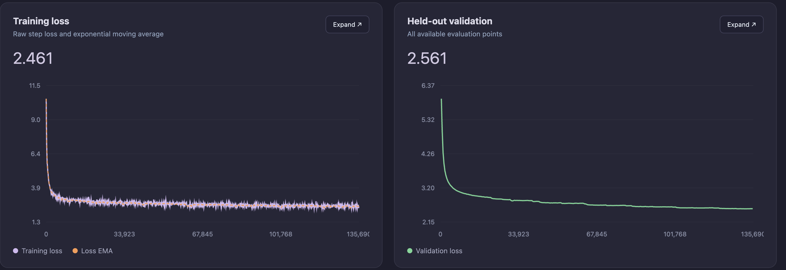

# OpenSML-JSONLite-175M-Instruct: native JSON technical report

**Author:** William Zebrowski · **Parameters:** 175,611,648 · **Date:** 2026-10-16

## 1. Current artifact and behavior

The main checkpoint directly generates JSON from source text and a supplied JSON Schema. A single native autoregressive request emits the entire object. There is no fieldwise extraction-to-JSON assembler, answer repair, constrained decoder or gold-conditioned filling in the current inference path. Parsing and schema validation happen only after generation; the raw generated string is retained even when incorrect or invalid.

Current artifact: **main checkpoint**, BF16 `model.safetensors`, 351,242,342 bytes.
SHA-256: `781597baeb9b51d535fc27cd6f941dbc202e01d62c8d963587a3f3d565128560`.
This is a custom native MLX architecture, not a Transformers/MLX-LM auto-loader export.

This report supersedes the earlier fieldwise SFT-093 release. Its historical report is retained as `HISTORICAL_SFT093_REPORT.md`; those adapter-assisted scores are not current native JSON scores. No release-readiness or arbitrary-schema reliability claim is made.

### Intended use in plain language

This is a research model for **extracting information that is explicitly stated in short English text** and placing it into one flat JSON object. Supply a schema with clear field descriptions. The verified runner accepts 1–8 required fields containing strings, nullable strings or arrays of strings. Dates and numbers are copied as text rather than normalized or converted.

**Expect extraction mistakes.** The model can shorten a name or title, miss or merge list items, confuse who or what a value belongs to, or supply a value when the right answer is empty. Unfamiliar field names and domains need their own testing. There is no established number of entities it will always extract correctly; only 3 of the 6 observed three/four/five-item probes were completely correct.

**Outside the verified scope:** nested objects, arrays of objects, numeric or Boolean outputs, optional-property logic, enums, references and advanced schema constraints. General chat, multilingual input and long-document extraction are also unverified. This describes the released runner's tested contract, not a claim that the weights can never produce these formats.

**Check both structure and meaning.** Parse the output, validate it against the schema, and check the values against the source. The reported 100% schema validity applies to the observed 1,444-request evaluation; complete correctness there was 88.02%. It is not a promise for new inputs. The instruction, source, schema and generated answer must share the 2,048-token context; the supplied runner allows up to 256 output tokens.

## 2. Exact inherited lineage

`Stage A → grounded QA → requested-field extraction → focused extraction → native JSON foundation → cardinality/replay extraction → joint JSON extraction SFT`

Only those selected checkpoints are inherited. Other trials and failed RL/JSON experiments are research history, not hidden additional ancestors. The architecture and frozen tokenizer remain unchanged. Each SFT stage resets its local counters and AdamW optimizer while continuing the inherited neural weights.

| Stage | Inherited update | Presentations through selected artifact | Serialized positions |
| --- | ---: | ---: | ---: |
| Stage A pretrained | 132005 | Document stream | 17,300,111,360 lifetime pretraining positions |
| SFT-065 grounded QA | 469 of 782 | 15,008 | 3,097,331 |
| SFT-068 requested-field extraction | 379 | 12,115 | 1,842,593 |
| SFT-093 focused extraction/replay | 160 | 5,120 | 706,399 |
| SFT-100 native JSON | 469 | 15,000 | 4,634,126 |
| Additional extraction SFT | 64 selected of 96 completed | 2,048 | 600,558 |
| Joint JSON extraction SFT | 300 of 331 | 19,200 | 6,153,194 |
| Inherited post-training total | 1,841 updates | 68,491 | 17,034,201 |

The latest stage metadata counter records 633,561 supervised assistant positions; its serialized count above was recomputed from the exact selected shuffle prefix. Presentation counts include repeated source views. Serialized positions include masked prompt tokens; they are not supervised-output-token counts. The earlier 150M model weights did not initialize this model; the earlier frozen OpenSML tokenizer was reused.

## 3. Architecture and parameterization

The same architecture is retained across pretraining and all inherited SFT stages. No new extraction head, adapter or vocabulary was introduced.

| Setting | Value |
| --- | --- |
| Architecture | Causal decoder-only transformer |
| Parameters | 175,611,648 |
| Layers | 24 |
| Hidden size | 768 |
| Query heads | 12 |
| KV heads | 4 |
| Head size | 64 |
| Attention | Grouped-query causal attention |
| Position encoding | RoPE, base 10,000 |
| Normalization | Pre-norm RMSNorm; query/key RMSNorm enabled |
| Feed-forward | SwiGLU |
| FFN hidden size | 2048 |
| Configured MLP ratio / rounding | 4.0 / multiple 256; implementation uses 2/3 sizing |
| Embedding / output projection | Tied weights |
| Projection biases | Disabled |
| Vocabulary | 32000 |
| Context per model call | 2048 |
| Attention implementation | MLX fast attention |
| FFN implementation | Packed Metal SwiGLU |
| Training CE implementation | Metal cross entropy, FP32 reductions |

Implementation evidence: [`model.py`](../provenance/LINEAGE.json), [`precision.py`](../provenance/LINEAGE.json), and the final bundle's `recipe.model` metadata. Weight count and file size are consistent with BF16 parameters plus the safetensors header. GPU allocation readings are not equivalent to file size, total process RSS or system RAM requirements.

The base initialization is recorded as `normal-0.02-residual-scaled-v1`. Earlier OpenSML-150M **weights** were not used to initialize the base; its frozen tokenizer was reused.

## 4. Tokenizer and serialization

The model uses the project's frozen 32K byte-level BPE tokenizer at `reference/opensml-150m/tokenizer/bytebpe32k_v1`. No tokenizer retraining occurs in the inherited SFT stages. Its own manifest has format `sml-v2-tokenizer-v1`; the format name is not a model-weight lineage claim.

| Tokenizer artifact | SHA-256 |
| --- | --- |
| Tokenizer manifest / contract fingerprint | 1194292 c 6 d 906 ac 19e 6 f 01 c 6 ad 2 b 42825143 fad 426 a 22 aa 8856 d 903776701ecb |
| tokenizer.json | e 095 f 0413 a 11 fa 91 fbb 58 f 37 d 00e 4 c 6 bcda 59 beb 89 b 28 f 6 f 680 db 1436 a 7e 8891 |
| tokenizer_config.json | 619 f 500553367eb 76 f 5 be 00 a 98625130ec 857 b 9 c 367561334984096 c 029 ba 2 a 9 |
| tokenizer corpus.json | e 4 c 47 b 7 b 6 aba 08 f 948 de 7 c 2 c 7 cb 94 c 58 dbd 09 dde 2 ded 6 ac 185 c 60856ee 686 d 27 |

Structural token IDs:

| ID | Token | Meaning |
| --- | --- | --- |
| 0 | `<\|pad\|>` | Padding |
| 1 | `<\|doc_end\|>` | Document/end-of-sequence marker |
| 2 | `<\|turn_start\|>` | Role/turn header |
| 3 | `<\|turn_end\|>` | End of a conversational-format turn |

`pretraining/sft/data.py` constructs explicit IDs rather than assuming a generic Hugging Face chat template. A user turn is `turn_start + encode("user\n") + content + turn_end`. An assistant target has the corresponding assistant header, response and turn-end marker; training additionally appends document-end. Generation ends its prompt at the assistant header. User text and role headers are masked from the supervised loss. Assistant content, assistant turn-end and the appended document-end are supervised.

Ordinary text must round-trip through the tokenizer and cannot emit reserved structural IDs. Special-token-looking content can be rejected by the tokenizer; the API does not promise unrestricted literal handling of all structural strings. Prompt/output limits are checked without truncating source text.

## 5. Pretraining corpus and curation

The selected base is the best retained checkpoint at update 132005 after **17,300,111,360 processed token positions**. The original budget was 20B; a continuation was configured toward 30B, but this inherited checkpoint is not a completed 20B or 30B artifact.

Source weights below are intended processed-token sampling weights, not measured unique-document shares. No claim of 17.3B globally unique corpus tokens is made.

| Source | Sampling weight (%) | Repository / configuration | Pinned revision | Additional selection |
| --- | --- | --- | --- | --- |
| FineWeb-Edu | 50 | HuggingFaceTB/smollm-corpus / fineweb-edu-dedup | 3 ba 9 d 605774198 c 5868892 d 7 a 8 deda 78031 a 781 f | Deduplicated educational subset |
| DCLM-Edu | 18 | HuggingFaceTB/dclm-edu | dbad 8 ad 71224482740 cd 9 c 9 d 353591 adbf 62 fe 04 | edu_int_score≥3 |
| FineWiki English | 13 | HuggingFaceFW/finewiki / en | 8 bd 13e 72e 6 a 002407649 b 3e 898535 f 42 ceb 1 aeb 9 | English |
| Cosmopedia v2 | 9 | HuggingFaceTB/smollm-corpus / cosmopedia-v2 | 3 ba 9 d 605774198 c 5868892 d 7 a 8 deda 78031 a 781 f | Format contains textbook/tutorial/blog/educational |
| Python text mirror | 10 | Avelina/python-edu-cleaned / default | 3 fedf 55e 02e 72 dd 1 fd 68963 f 991 f 5e 91 adcb 0 f 8 d | int_score≥4 |

Public source cards: [SmolLM corpus](https://huggingface.co/datasets/HuggingFaceTB/smollm-corpus/blob/3ba9d605774198c5868892d7a8deda78031a781f/README.md), [DCLM-Edu](https://huggingface.co/datasets/HuggingFaceTB/dclm-edu/blob/dbad8ad71224482740cd9c9d353591adbf62fe04/README.md), [FineWiki](https://huggingface.co/datasets/HuggingFaceFW/finewiki/blob/8bd13e72e6a002407649b3e898535f42ceb1aeb9/README.md). The Python-Edu upstream subset identifies files; this run used the configured text mirror. The mirror's pinned README could not be retrieved during report preparation, so its provenance statement here comes from the local corpus specification, not a newly completed external audit.

The exact corpus specification is [`configs/corpus_20b.json`](../provenance/LINEAGE.json). Training preserves source text and code indentation. NFC/whitespace normalization is used for identity hashing and partitioning, not to rewrite model input.

The content-split policy hashes identity into 10,000 buckets: 97% training, 1% validation, 1% final and 1% tokenizer development. Identity checks do not establish that a supervised benchmark article never appeared elsewhere in pretraining web data.

Recorded stream settings are a 256-document accepted-document shuffle buffer, bounded 100,000-document deduplication window, 4 prefetched batches and up to 5 retry attempts. The corpus JSON's generic 10,000 shuffle value is not the active stream override. Filtering rejects documents below 200 characters, above 200,000 UTF-8 bytes, with null characters, excess replacement characters or an excessive repeated-line pattern. Source exhaustion fails rather than silently recycling. Deduplication is bounded; it is not global semantic or fuzzy deduplication.

## 6. Pretraining execution, optimization and validation

Pretraining runs on the recorded five-Mac Apple Silicon cluster. Mac 1's current local hardware was independently checked during report preparation as an Apple M5 Ultra with 96 GB unified memory. Other worker descriptions below are historical cluster records, not newly queried hardware inventories.

| Mac | Recorded chip | RAM | Microbatch | MLX cache cap |
| --- | --- | --- | --- | --- |
| 1 | M5 Ultra | 96 GB | 7 | 16 GiB |
| 2 | M3 Ultra | 96 GB | 3 | 16 GiB |
| 3 | M4 Max | 36 GB | 2 | 4 GiB |
| 4 | M4 Max | 36 GB | 2 | 4 GiB |
| 5 | M4 Max | 36 GB | 2 | 4 GiB |

The physical ring is 1→2→3→5→4→1. Four accumulation microsteps and 2,048-token sequences produce `(7+3+2+2+2)×4×2048=131072` positions/update. Unequal-rank gradients are weighted by token counts. Early batch transitions mean the lifetime token count is not simply `132005×131072`.

- First 125 updates: microbatches [4,4,2,2,2], 114,688 positions/update, 14,336,000 tokens.
- From 125: microbatches [6,4,2,2,2], 131,072 positions/update.
- From 963 / 124,174,336 tokens: [7,3,2,2,2], same global batch; per-Mac cache caps recorded.
- Stage A continuation starts from 113313 / 14,850,113,536 tokens, retaining weights, FP32 optimizer state, source cursors, counters and controller history.
- Selected base: 132005 / 17,300,111,360 tokens.

Ethernet supports SSH orchestration; the training ring uses verified Thunderbolt/RDMA links. Sequential microbatch materialization, FP32 gradient accumulation and custom Metal paths were used. Public documentation must not include private SSH identities, addresses, access credentials or machine serial numbers.

| Pretraining optimizer/schedule | Recorded setting |
| --- | --- |
| Optimizer | AdamW |
| Nominal peak LR | 3e-4 |
| Original warmup | 200M tokens, 1% of the 20B budget |
| Base schedule | Warmup/stable interval/cosine; continuation stretches nominal decay to 24B–30B |
| Adaptive controller | Factor 0.8; patience 12 evaluations; cooldown 10; minimum delta 0.002 |
| Controller LR floor | 3e-5 |
| Effective cap at selected 132005 | 3.221225472e-5 |
| Recorded controller reductions / evaluations | 9 / 242 |
| Betas | (0.9,0.95) |
| Epsilon | 1e-8 |
| Weight decay | 0.1 |
| Gradient clipping | 1.0 |
| Seed | 7337 |
| Loss | Next-token cross entropy; FP32 reductions |

The nominal 3e-4 schedule is not the effective late-run learning rate: the retained controller cap bounds it. The record does not justify a claim that the run trained at 3e-4 for all 17.3B positions.

Validation and qualitative samples occur at 50M-token boundaries. The fixed validation panel has 32 batches/source, batch 2, five sources, context 2,048: nominally 655,360 positions/event. Aggregate loss is source-mixture weighted. Validation fingerprint: `4ddd461c131d4d27d07bb07f5aab3fcb5a00d4b1202066e3d9b6ee6b3129087b`. Selected-base validation loss is **2.5563359551876785**, perplexity **12.8885**. This measures document prediction, not extraction or chat reliability.

Regular saves occur every 100M tokens, plus best-validation and clean-stop saves. Exact checkpoint metadata is authoritative. The initial October 2 technical report's early observations, 20B target and old schedule describe history; they are superseded here for this selected artifact. Contemporary qualitative logs often showed roughly 41 k tokens/s, but no reproducible end-to-end cluster performance/energy benchmark is established by this report. The separate 42.7 k profiling candidate is not claimed as the configuration that trained this checkpoint.

### Training run

The 175.6M-parameter base was trained from random initialization using next-token prediction across the educational web, Wikipedia, Cosmopedia and Python mixture. Five Apple Silicon Macs carried out distributed pretraining over Thunderbolt/RDMA. Validation was measured every 50M tokens. The curves show a steep early loss reduction followed by slower improvement; the published base was selected using held-out validation.

*Training loss and held-out validation during pretraining. Left: raw training loss and exponential moving average. Right: held-out validation loss.*

## 7. Inherited supervised foundation and prior extraction continuation

The four inherited foundation stages remain unchanged: grounded evidence QA (15,008 presentations through its selected checkpoint), requested-field SNIPS extraction (12,115), focused single-field extraction/replay(5,120), then directly supervised native JSON (15,000). Their original source and checkpoint records remain in provenance. Each stage uses full model weights, fresh AdamW, BF16 computation with FP32 master weights/moments/gradient accumulation, and assistant-output-only supervision. No RL, LoRA or added extraction head is in this lineage.

The native JSON foundation has 12,115 distinct SNIPS TRAIN requests, with 12,115 canonical string-array schemas, 1,443 renamed-key views and 1,442 nullable-string views. Source text, field definitions and the complete schema are input; complete JSON and stop tokens are the assistant target. Original CC0 SNIPS chunk annotations provide source spans. Metadata fidelity and schema validation do not establish perfect semantic annotation. Frozen tokenizer and architecture are unchanged.

### Prior cardinality/replay extraction SFT

This completed continuation starts from the native JSON foundation. It adds matched zero/one/two/three-value supervision for artists and cities, including zero-primary-value cases where an album or country is explicitly present. It retains original JSON TRAIN replay and adds frozen-parent distribution distillation on replay assistant tokens. Every model batch has 24 replay and 8 new views. This is an inherited ancestor of the current main checkpoint.

| Setting | Value |
|---|---|
| Prepared corpus |3,072 presentations: 2,304 original TRAIN replay +768 authored schema views|
| Distinct authored source requests in prepared corpus |256|
| Prepared replay variants |1,344 canonical, 480 renamed, 480 nullable|
| Completed experiment |96 optimizer updates, one pass, 900,453 serialized positions|
| Inherited selected prefix |2,048 presentations, 600,558 positions, 64 updates|
| Inherited prefix mixture |1,536 replay views from 1,482 source texts +512 authored views from 250 source texts|
| Model adaptation |Full weights; Mac 1 only; fresh AdamW|
| Batch / microbatch |32 /2|
| Peak / final schedule LR |2e-6 /2e-7 over 96 updates|
| Warmup |6 updates; cosine afterward|
| Betas / epsilon |(0.9,0.95) /1e-8|
| Weight decay / clipping |0.01 /1.0|
| Seed |20261119|

The current weights inherit only this ancestor’s selected prefix; updates after that ancestor are not part of these weights. The endpoint's actual learning rate is recorded by the cosine schedule, not the planned final LR. Presentation counts include multiple schemas for the same text and do not mean distinct user queries.

For every row, CE is averaged over supervised assistant tokens within each sequence, then averaged across sequences. On original TRAIN replay add 1.0×KL(frozen foundation || student), using the full 32,000-token distribution, temperature 1 and teacher-forced ground-truth histories. Only assistant JSON and turn/document-stop positions participate. The reference network is frozen/stop-gradient; new authored rows use CE alone. This regularizer is training-only: no teacher is needed for inference, and it does not guarantee retention or repair parent errors.

The new views use literal original SNIPS TRAIN values with split-disjoint authored value pools/phrases, excluding observed evaluation source texts and holding new authored DEV/TEST values out of replay. Source text, exact offsets, schema/gold agreement, masks, token budgets and hashes were checked. Twenty-eight tests, GPU accumulation checks, frozen-reference checks and a temporary optimizer/checkpoint-resume smoke passed. Authored examples are programmatic controlled supervision, not independently collected user traffic. SGD, MIT Movie and other newly researched datasets are **not** in this checkpoint.

### Latest joint JSON extraction SFT

The latest full-weight SFT jointly mixes original source/schema/JSON training replay, controlled multiple-value examples and authored natural-language passages across the seven SNIPS domains. The prepared corpus contains **21,144 presentations**: 15,000 original JSON views, 768 cardinality replay views and 5,376 controlled prose presentations (1,753 distinct new texts). The released main checkpoint inherits **19,200 presentations** from one deterministic shuffle: 13,640 original JSON views, 689 cardinality views and 4,871 prose views. It processes **6,153,194 serialized positions**, including **633,561 supervised assistant positions**. Later updates from the completed experiment are not included.

The run uses full-weight BF16 compute with FP32-master AdamW, batch 64, microbatch 2, betas (0.9, 0.95), epsilon 1e-8, zero weight decay and gradient clipping at 1. A fresh optimizer warms up over 20 updates to 5e-6, then follows a cosine schedule toward 1e-6 over the full 331-update experiment. Only assistant JSON and the turn-ending token contribute to mean per-request token cross-entropy. There is no teacher KL, LoRA or RL in this latest stage. Source text, schema and instruction tokens are masked. The inherited earlier cardinality stage used training-only distillation; no teacher is used at inference.

## 8. Prompt, schema and native inference

Supply source text and a flat closed JSON Schema with 1–8 required fields. Supported properties are strings, nullable strings and arrays of strings. The requested behavior is to return every required key, with [] for absent arrays and null for absent nullable strings; generated answers can still be incorrect. Copy case/spelling and complete values; preserve source order. Nested schemas, numbers/booleans, enums and advanced constraints are outside the verified runner contract. The supplied runner rejects overlong inputs without truncation.

The fixed instruction is followed by compact `{"source_text":...,"schema":...}` and native SFT role tokens. It issues exactly one autoregressive whole-object generation with temperature 0, repetition penalty 1 and at most 256 output tokens. No fieldwise assembly, repair, schema-constrained decoder, normalization, reference answer, frozen teacher or secondary model is used at inference. Parsing/schema checks only annotate the raw generated text afterward.

## 9. Evaluation and release selection

| Metric | Main checkpoint | Previous release |
| --- | ---: | ---: |
| Entire request correct | **88.02%** | 83.03% |
| Field accuracy | **94.17%** | 91.36% |
| Extracted-value F1 | **92.88%** | 90.40% |
| Extracted-value precision | **92.42%** | 90.53% |
| Extracted-value recall | **93.35%** | 90.26% |
| Missing-field accuracy | **95.22%** | 92.79% |
| Schema-valid JSON | **100.00%** | 99.79% |

Complete correctness is **1,271/1,444**, compared with 1,199/1,444 for the previous release: **96 improved requests and 24 regressions**, a net gain of 72. All seven domain aggregate correctness totals improve. Paired-source correctness rises from 512/694 to **561/694**. False abstentions fall from 107 to **53**, missed missing fields from 110 to **73**, and unsupported predicted values from 27 to **24**. All 1,444 outputs parse, validate and stop naturally; there are no output-budget failures.

The separate observed 60-case playground scores **49/60 (81.67%)**, compared with 45/60. Its original 54-case subset scores 46/54; the six added three/four/five-item probes score 3/6. Three larger-list probes still fail. The compact 240-request development panel scores 178/240 (74.17%). These panels measure different scopes and must not be pooled. They have prior research exposure and are not fresh blind benchmarks or an external leaderboard.

The main checkpoint was selected for aggregate improvement despite failing the strict zero-lost-case development gate. Individual regressions remain; improved aggregate scores do not establish universal retention or production reliability.

| Metric | Main checkpoint | Previous release |
| --- | ---: | ---: |
| Entire request correct | **88.02%** | 83.03% |
| Field accuracy | **94.17%** | 91.36% |
| Extracted-value F1 | **92.88%** | 90.40% |
| Extracted-value precision | **92.42%** | 90.53% |
| Extracted-value recall | **93.35%** | 90.26% |
| Missing-field accuracy | **95.22%** | 92.79% |
| Schema-valid JSON | **100.00%** | 99.79% |

### Correctness by domain

| Domain | Previous | Main | Requests |
| --- | ---: | ---: | ---: |
| AddToPlaylist | 165 | 172 | 206 |
| BookRestaurant | 162 | 172 | 208 |
| GetWeather | 164 | 178 | 206 |
| PlayMusic | 153 | 164 | 208 |
| RateBook | 193 | 195 | 204 |
| SearchCreativeWork | 197 | 199 | 208 |
| SearchScreeningEvent | 165 | 191 | 204 |

### Protocol and contamination limits

Greedy temperature 0, repetition penalty 1, maximum 256 output tokens and the unchanged native serialization. Every request supplies only the source text, schema and fixed extraction instruction. References, gold spans and offsets are used after generation only. No prompt truncation, constrained decoding, secondary model, JSON assembly or repair is used. Strict parsing rejects duplicate keys and nonfinite constants. Complete correctness requires a natural stop, valid JSON and schema, and exact agreement of all fields. Lists retain order; value precision/recall/F1 compare extracted values, while field accuracy includes missing fields. The full machine-readable result includes counts, denominators, paired correctness, unsupported values and stopping metrics.

The 1,444 requests comprise the original canonical and schema-stress views; some views reuse the same source. Previously observed tests and playground examples informed research and owner selection. They are not a fresh blind holdout. Synthetic prose shares construction families and training entities, so gains do not establish open-domain generalization. The selected checkpoint is a preserved no-pruning replay artifact identified by its exact hash; metrics are recomputed from that artifact's saved generations, not borrowed from an earlier artifact. No claim of bitwise training replay identity is made.

## 10. Failure audit and limitations

### What the released model is intended to do

The intended task is short English text extraction into a supplied, flat object schema: copy stated values into the requested fields, keep separate entities as separate string-array items, and use empty arrays or nullable strings for absent information where the schema allows it. Clear field descriptions matter. The runner accepts 1–8 required fields with strings, nullable strings or arrays of strings; dates and numeric expressions remain strings. Those input limits describe the runner contract and do not guarantee that every accepted request will be answered correctly.

### What can still go wrong

The model can shorten names or titles, omit or merge list members, confuse roles or field meanings, and fill a missing field with an unsupported value. Corrections, unfamiliar field names, new domains and complex associations require application-specific evaluation. No tested field count or entity count establishes a reliable extraction maximum. Optional-property logic, nesting, arrays of records, numeric/Boolean outputs, enums, references and advanced constraints are outside the released runner's verified contract. Root-level arrays or primitives, general chat, multilingual use and long-document extraction are not supported claims of this release. Unverified does not mean impossible for the weights; it means the supplied runner and release evidence do not establish dependable support.

| Evidence for this released checkpoint | What it establishes | What it does not establish |
| --- | --- | --- |
| 1,271/1,444 complete requests correct (88.02%) | Exact whole-answer performance on the documented, previously observed SNIPS-derived panel | Equivalent accuracy on arbitrary schemas or new domains |
| 1,444/1,444 schema-valid outputs | All outputs met the tested flat schemas in that evaluation | Correct extracted values, or universal schema compliance |
| 49/60 complete playground requests correct (81.67%) | Performance on a separate observed diagnostic panel | A fresh blind benchmark or a general production reliability rate |
| 3/6 complete three/four/five-item probes correct | Larger lists remain inconsistent | A guaranteed maximum number of extractable entities |

These measurements use the released checkpoint identified in section 1. Local research checkpoints are separate artifacts; their broader-schema or per-family scores are not measurements of this release. The panels have prior research exposure and must not be pooled into one accuracy number.

### Checks required in an application

Parse the raw output, validate it against the supplied schema, then check that extracted values are supported by the source and assigned to the right fields. A valid string can still name the wrong person, omit an item or invent a value; schema validation cannot detect all such errors. The runner's `success` flag means structural validity and natural completion, not semantic correctness. The full instruction, source, schema and answer share a 2,048-token context, and the released runner allows up to 256 generated tokens. Overlong inputs are rejected rather than truncated. Validate the complete workflow on representative application data before relying on its outputs.

### Additional failure-audit observations

There are 173 entirely incorrect original-test requests and 24 previously correct requests become incorrect. Errors include incomplete copying, wrong roles, missing or extra values and unsupported values. All seven domain totals improve, but per-request retention is not perfect. On the six longer-list probes only three are correct. Flat schema validity is 100% on this test, not a guarantee for arbitrary prompts, schema types or novel domains. No general chat, reasoning, code, multilingual, long-document or safety readiness claim is made. The authored development panel is small and repeatedly observed.

## 11. Packaging, verification and reproduction

The main package uses BF16 weights, the unchanged tokenizer and the supplied native MLX runner. The verification receipt records stock-MLX raw-string and stop-reason parity on all 60 observed playground fixtures. This establishes packaging parity within the stated scope, not full 1,444-case cross-runtime parity or an independent benchmark. Standard `model.safetensors` and the public model ID remain unchanged. Previous Hub and Git revisions retain rollback identities.

The source archive includes the frozen latest training recipe, prepared JSONL corpus and input hashes, exact prefix counts, saved generated answers, scorer and matched parent comparisons. Public copies sanitize private workspace paths and distinguish original from distributed hashes. Optimizer binaries and packed pretraining pools are omitted. Reproduction requires the specified parent and layout, compatible dependencies, and fresh local preflight receipts; sanitized audit receipts are not resumable optimizer state. See TRAINING_AND_REPRODUCIBILITY.md, provenance/LINEAGE.json, results/JSONLITE_RESULTS.json and pretraining/native_json_128/ in the archive.

## 12. Attribution and licensing

Source code retains Apache-2.0; upstream data and dependencies retain their notices. Original SNIPS annotations are CC0; the matched cardinality examples are programmatically authored from TRAIN literals. The earlier SQuAD/Dolly/pretraining source notices remain in THIRD_PARTY_NOTICES.md. Source licensing does not automatically assign a trained-weight license; none is assigned by this update.

Hugging Face edition: archive-relative code/evidence references resolve inside native_bundle.zip.
