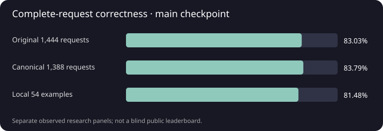

---
language:
- en
pipeline_tag: text-generation
library_name: mlx
base_model: wzebrowski/OpenSML-Base-175M
base_model_relation: finetune
tags:
- information-extraction
- structured-output
- json
- small-language-model
- apple-silicon
- from-scratch
- post-training
- research
datasets:
- HuggingFaceTB/smollm-corpus
- HuggingFaceTB/dclm-edu
- HuggingFaceFW/finewiki
- Avelina/python-edu-cleaned
- rajpurkar/squad_v2
- databricks/databricks-dolly-15k
---

# OpenSML-JSONLite-175M-Instruct

**Author:** William Zebrowski · **175,611,648 parameters**

[Run locally](../RUN_GUIDE.md) · [Technical report](../docs/TECHNICAL_REPORT.md) · [Results](../results/JSONLITE_RESULTS.json) · [Provenance](../provenance/LINEAGE.json) · [Inference verification](../inference_native/INFERENCE_VERIFICATION.json)

**A small language model that generates JSON directly from source text and a supplied JSON Schema.** It produces the entire object in one native autoregressive request. There is no fieldwise JSON assembler, output repair or constrained decoder in this release. Schema validation happens after generation and cannot establish that extracted values are correct.

This update replaces the earlier extraction-plus-assembly weights and runner with a native source/schema → JSON fine-tune. The pretrained ancestor is [OpenSML-Base-175M](https://huggingface.co/wzebrowski/OpenSML-Base-175M); the model adds evidence QA, exact field extraction, focused extraction and a final directly supervised JSON stage. Full lineage and exact artifact hashes are in the report.

## Run locally

The repository contains BF16 `model.safetensors`, tokenizer/configuration, native MLX source archive, runnable entry point, examples and verification/results records. This is a custom architecture; use the supplied runner rather than Transformers AutoModel or mlx-lm auto-loading. Verified platform: Apple Silicon macOS, Python 3.11 and stock MLX 0.32.3.

```bash
python3 -m venv .venv
source .venv/bin/activate
python -m pip install huggingface_hub
# Authenticate if access requires it: hf auth login
hf download wzebrowski/OpenSML-JSONLite-175M --local-dir OpenSML-JSONLite-175M
cd OpenSML-JSONLite-175M
python -m pip install -r requirements.txt
python inference.py --example 29
python inference.py --text-file request.txt --schema-file schema.json
# Optional: raw text plus validation/stop metadata and example correctness
python inference.py --example 29 --json
```

Default stdout is the model's unmodified generated text. The fixed extraction instruction and native prompt template are supplied by the runner. Example answers are checked afterward and never passed to generation. After downloading and installing dependencies, inference runs offline. The root runner verifies the source archive and selected weight SHA-256. Tokenizer companions are in the bundle; optimizer state is not needed for inference.

## Model and inputs

| Setting | Value |
| --- | --- |
| Parameters | 175,611,648 |
| Layers / hidden / FFN width | 24 / 768 / 2,048 |
| Attention | GQA, 12 query heads / 4 KV heads |
| Normalization / MLP / positions | RMSNorm + Q/K norm / SwiGLU / RoPE 10,000 |
| Vocabulary / context | Frozen 32,000-token byte-BPE / 2,048 shared tokens |
| Embeddings / biases | Tied input-output / no linear biases |
| Weights | BF16, unquantized safetensors |
| Output | One native JSON object per request |
| Default decoding | Temperature 0, repetition penalty 1, max 256 output tokens |

Supply source text containing the facts and a closed flat object schema with 1–8 required properties and `additionalProperties: false`. Supported property types are strings, nullable strings (`["string","null"]`) and arrays of strings. Clear field descriptions help specify semantics. Missing arrays target `[]`; missing nullable strings target `null`. Strings preserve source case/spelling and arrays preserve source order; number/date normalization is not trained. Overlong inputs reject without truncation.

The run is trained primarily on seven SNIPS domains and 39 field definitions. New names/descriptions are passed to the model directly, but reliable unfamiliar-domain extraction has not been established. Nested schemas, numeric/boolean outputs, enums, references and advanced constraints are outside the verified runner contract.

Example source: `Play the track Blue Lantern by Mira Sol.` With a schema requesting track, artist and album as string arrays, actual native output is:

```json
{"track":["Blue Lantern"],"artist":["Mira Sol"],"album":[]}
```

## Training

The 175.6M-parameter base was pretrained from random initialization on **17,300,111,360 lifetime token positions**, using a five-Mac Apple Silicon cluster with Thunderbolt/RDMA.

| Pretraining source | Intended sampling share |
| --- | ---: |
| FineWeb-Edu | 50% |
| DCLM-Edu | 18% |
| English FineWiki | 13% |
| Cosmopedia v2 | 9% |
| Educational Python | 10% |

These are configured token-sampling weights, not unique-document counts. Selected-base validation loss was 2.5563359552. Pretraining architecture, tokenizer, source revisions, filtering, scheduler and precision are documented in the report.

### Training run


*Training loss and held-out validation during pretraining. Left: raw training loss and exponential moving average. Right: held-out validation loss.*

### Supervised adaptation

| Stage | What it teaches | Inherited training |
| --- | --- | --- |
| Grounded QA | Answers from evidence, absence, contrasting questions, multipart/corrections | 15,008 presentations through selected update 469 |
| Requested-field extraction | Exact SNIPS annotated spans, field definitions, missing values | 12,115 requests / 379 updates |
| Focused extraction | Single-field supervision plus labeled replay | 5,120 presentations / 160 updates |
| **Native JSON SFT** | **Source text + full schema → JSON assistant targets** | **15,000 presentations / 469 updates** |

The final JSON stage has **12,115 distinct source requests**: 12,115 canonical-schema examples, 1,443 renamed-key views and 1,442 nullable-string views. Additional views reuse TRAIN-only sources. Original SNIPS chunk annotations are reconstructed, checked against source offsets and schema-validated; upstream annotation fidelity is not a guarantee of perfect semantic golds.

The final stage runs one full-weight pass on Mac1 with batch 32, microbatch 2, fresh AdamW, peak LR 5e-6/final 1e-6, 20-update warmup then cosine decay, betas (0.9,0.95), epsilon 1e-8, weight decay 0.01 and clipping 1. Only assistant JSON and stop tokens contribute to the loss. It processes 4,634,126 serialized positions; there is no RL or adapter-only training in this chain.

DEV selection happens at updates 0/100/200/300/469 on 252 fixed requests. The final artifact is selected before the 1,444-request test. TRAIN/DEV/TEST source groups are separate, but these held-out panels have prior research exposure and are not a new blind benchmark.

## Native JSON evaluation

| Metric | Adapted SNIPS held-out, 1,444 requests |
| --- | ---: |
| Entire request correct | **1,191/1,444 — 82.48%** |
| Field accuracy | **91.31%** |
| Extracted-value precision / recall / F1 | **90.55% / 90.41% / 90.48%** |
| Missing-field accuracy | **92.46%** |
| Schema-valid JSON | **99.79%** |
| False abstentions / unsupported values | 111 / 30 |
| Token-limited outputs | 0 |

Canonical string-array schemas alone score **1,156/1,388 (83.29%)**, with 100% schema validity. Extra renamed-key and nullable-string views score **19/28** and **16/28**. The full 54-case local playground scores **42/54 (77.78%)**, including **7/12** previously authored natural examples. These are different panels; do not pool or present them as an external leaderboard.

All outputs are raw, greedy native model generations: one whole-object request, no constrained decoder, assembly, repair, prompt truncation or reference answer in inputs. Complete correctness requires natural completion, strict JSON/schema validity and exact values. Structural validity is not factual correctness. [Results](../results/JSONLITE_RESULTS.json) and the report contain counts, per-domain performance, protocols and failures.



## Limitations

The model remains a focused extraction research candidate. Failures include inventing a city, omitting second values, merging two names, missing rating/cuisine information, confusing entity types, incomplete spans, duplicate keys and malformed nullable strings. Broader natural language, corrections, associations, unfamiliar definitions, long documents and complex schemas need further validation. General dialogue, coding, multilingual quality, confidence calibration and prompt-injection robustness are not established. `success` means natural completion and structure validity, not verified factuality or release readiness.

## Identity and packaging

Selected weight SHA-256:

`656f45015aab548465d93bed0b57e687497163741885da7364872851fa17e9a4`

Weights have 351,242,342 bytes. The frozen tokenizer is unchanged. Clean stock-MLX packaging verification checks raw output text and stop reasons against all 54 actual playground predictions; its 42/54 correctness is the same observed result, not an independent blind test or full-heldout runtime-parity claim. CUDA, CPU-only, quantized and converted exports remain unverified.

Source code uses Apache-2.0; upstream data/dependencies retain their terms. The source license does not automatically assign a model-weight license. See the included notices and provenance.
