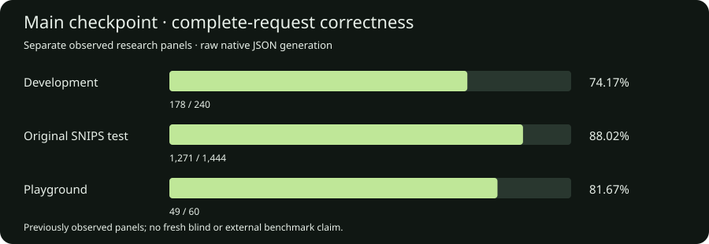

---
language:
- en
pipeline_tag: text-generation
library_name: mlx
base_model: wzebrowski/OpenSML-Base-175M
base_model_relation: finetune
tags:
- information-extraction
- structured-output
- json
- small-language-model
- apple-silicon
- from-scratch
- post-training
- research
datasets:
- HuggingFaceTB/smollm-corpus
- HuggingFaceTB/dclm-edu
- HuggingFaceFW/finewiki
- Avelina/python-edu-cleaned
- rajpurkar/squad_v2
- databricks/databricks-dolly-15k
---

# OpenSML-JSONLite-175M-Instruct

**Author:** William Zebrowski · **Model:** OpenSML-JSONLite-175M-Instruct

[Run locally](../RUN_GUIDE.md) · [Technical report](../docs/TECHNICAL_REPORT.md) · [Results](../results/JSONLITE_RESULTS.json) · [Checkpoint provenance](../provenance/LINEAGE.json) · [Native inference verification](../inference_native/INFERENCE_VERIFICATION.json)

**A 175.6M-parameter English field extractor with a schema-guided JSON adapter.**

JSONLite takes short source text and a supported JSON Schema, extracts the requested values, and returns a structured object. The neural model generates labeled field values; software parses those values, assembles JSON and validates its structure. A request for multiple fields uses one model call per field.

The weights start from [OpenSML-Base-175M](https://huggingface.co/wzebrowski/OpenSML-Base-175M), trained from scratch through OpenSML Stage A pretraining, then adapted with grounded question answering, requested-field extraction and focused single-field extraction. **The inherited SFT lineage does not directly supervise raw JSON Schema → JSON targets.** The evaluated text-to-JSON capability is the checkpoint plus the supplied extraction/assembly adapter.

## Availability and inference

This repository includes the selected **BF16 `model.safetensors`**, frozen tokenizer, configuration, native inference runner, source bundle, examples and verified extraction results. Download the complete repository to run the model locally. The verified platform is Apple Silicon macOS with Python 3.11 and stock MLX 0.32.3.

This is a custom native MLX architecture. Use the supplied runner; it is not a Transformers AutoModel or mlx-lm auto-loading export. The source bundle contains the exact model implementation and schema-guided extraction/JSON adapter. Optimizer state is unnecessary for inference and is not included.

```bash
python3 -m venv .venv
source .venv/bin/activate
python -m pip install huggingface_hub
# If access requires authentication: hf auth login
hf download wzebrowski/OpenSML-JSONLite-175M --local-dir ./OpenSML-JSONLite-175M
cd OpenSML-JSONLite-175M
python -m pip install -r requirements.txt
python inference.py --example 29
# Your own source and schema:
python inference.py --text-file request.txt --schema-file schema.json
```

The root runner defaults to `model.safetensors`, verifies and temporarily extracts `native_bundle.zip`, then runs the frozen native implementation. After downloading the artifacts and installing dependencies, inference runs offline. The root `tokenizer.json` and `tokenizer_config.json` mirror the frozen tokenizer in the bundle, which includes its additional integrity metadata. See [RUN_GUIDE.md](../RUN_GUIDE.md) for complete instructions and an example schema.

The uploaded weight SHA-256 is:

`d552c1380c71c7c0569e9d692ec9c46c5c94bb87a7b024e56df0f0e36df4d798`

The CLI verifies this weight identity and the frozen tokenizer, then generates using greedy BF16 native MLX. It returns JSON, intermediate labeled outputs, natural-stop status and per-example exact equality if an example reference is available. References are scored after inference and never passed to the model. Custom requests use `--text-file request.txt --schema-file schema.json`. Source plus generation budget must fit 2,048 tokens per field call; overflowing input is rejected.

The portable runner was tested in a clean temporary environment with **stock MLX 0.32.3**, NumPy 2.4.2, Tokenizers 0.22.2 and jsonschema 4.26.0. All **40 saved playground values and stop reasons matched**; correctness against references remains **29/40**. This is packaging parity on those fixtures, not a full-suite runtime-parity or new blind accuracy result. Other platforms, framework conversions and quantized formats remain unverified.

## Model specification

| Field | Value |
| --- | --- |
| Parameters | **175,611,648 (175.61M)** |
| Layers / hidden width / FFN width | 24 / 768 / 2,048 |
| Attention | Grouped-query attention: 12 query heads / 4 KV heads, head dimension 64 |
| Position encoding | RoPE, base 10,000 |
| Normalization / MLP | RMSNorm, Q/K normalization, SwiGLU |
| Vocabulary / context | 32,000 / 2,048 per field call |
| Embeddings | Tied input and output |
| Linear biases | Disabled |
| Compute weights | BF16; no quantization |
| Training optimizer precision | FP32 master weights, moments and gradient accumulation |
| SFT serialization | Native turn-start / role / turn-end template |
| Adapter output | Closed JSON object; required fields contain arrays of strings |
| Default decoding | Temperature 0, repetition penalty 1, at most 160 generated tokens per field |

The frozen byte-level BPE tokenizer was fitted for the earlier OpenSML project and reused unchanged. Earlier OpenSML-150M model weights were **not** used to initialize this model. Tokenizer artifacts, structural IDs and their integrity checks are in the bundle and report.

## Training and model lineage

```text
Stage A pretrained/132005 → SFT-065/469 → SFT-068/379 → SFT-093/160
```

Only those selected stages are inherited. The many intervening research trials and failed RL/JSON experiments are not additional ancestors of the final weights.

### 1. General pretraining

The inherited Stage A checkpoint had processed **17,300,111,360 lifetime token positions**. It was trained from random initialization with document next-token prediction on five Apple Silicon Macs using Thunderbolt/RDMA. The nominal continuation target was higher; the selected parent is a **17.30B-position artifact**, not a completed 30B model.

| Source | Configured sampling share |
| --- | --- |
| FineWeb-Edu | 50% |
| DCLM-Edu | 18% |
| English FineWiki | 13% |
| Cosmopedia v2 | 9% |
| Educational Python text mirror | 10% |

These are intended processed-token sampling shares, not unique-document counts. Selected-base document validation loss was **2.5563359552**, perplexity **12.8885**, on the recorded fixed validation panel. This is document-prediction loss, not extraction accuracy.

Nominal pretraining peak LR was 3e-4, but the adaptive controller capped the effective LR at **3.221225472e-5** at the selected checkpoint. AdamW used betas (0.9, 0.95), epsilon 1e-8, weight decay 0.1 and gradient clipping 1.0. Exact warmup, batch-transition history, source revisions, filters and controller state are recorded in the technical report.

### Training run

The 175.6M-parameter base was trained from random initialization using next-token prediction across the educational web, Wikipedia, Cosmopedia and Python mixture. Five Apple Silicon Macs carried out distributed pretraining over Thunderbolt/RDMA. Validation was measured every 50M tokens. The curves show a steep early loss reduction followed by slower improvement; the published base was selected using held-out validation.


*Training loss and held-out validation during pretraining. Left: raw training loss and exponential moving average. Right: held-out validation loss.*

### 2. SFT-065: answering from supplied evidence

This stage starts directly from Stage A/132005. The prepared corpus has **25,000 grounded QA examples**: 12,000 natural QA, 5,000 contrasting questions, 3,000 answerability/calibration examples, 3,000 multipart questions and 2,000 corrections. Published inputs/answers come from selected SQuAD 2.0 and Dolly closed QA; controlled fictional examples use programmatically checked fact oracles.

The instruction asks the model to answer using only the supplied passage and return exactly `Not stated.` when unsupported. The complete run reached 782 updates, but **only selected update 469 is inherited**: **15,008 presentations / 3,097,331 serialized token positions**. Later updates are not part of JSONLite.

### 3. SFT-068: requested-field extraction

This stage continues from SFT-065/469 with **12,115 distinct curated SNIPS training queries** across playlist additions, restaurant bookings, weather, music playback, book ratings, creative-work searches and screening-event searches.

Each request supplies text, requested field names and definitions. Targets copy original annotated source spans into labeled lines, preserving source spelling and order. An absent field uses `field: NOT_STATED`. Date and number normalization are not performed.

It completes **379 updates**, **12,115 presentations** and **1,842,593 serialized tokens**. The selected checkpoint becomes the immediate parent for SFT-093.

### 4. SFT-093: focused extraction and replay

The final stage uses **2,560 original SNIPS TRAIN queries**: 1,920 accepted by a TRAIN-only verified parent-output bank plus 640 additional training queries. Each contributes an original replay view and a focused single-field view, producing **5,120 presentations**.

Every batch has 16 replay and 16 focused examples. The run completes **160 updates** and **706,399 serialized tokens**. No development, held-out benchmark or authored playground answers are added to training. The single-field target pool contains 1,900 present-field and 660 missing-field views; it is not exactly balanced.

All three SFT stages update the full model on Mac1 with assistant-output-only mean loss and a fresh AdamW optimizer. No RL, LoRA, added extraction head, frozen-layer adaptation or weight merging occurs in this inherited path.

| Setting | SFT-065 | SFT-068 | SFT-093 |
| --- | --- | --- | --- |
| Batch / microbatch | 32 / 2 | 32 / 2 | 32 / 2 |
| Selected update | 469 of 782 | 379 | 160 |
| Peak / planned final LR | 1e-5 / 2e-6 | 5e-6 / 1e-6 | 5e-6 / 1e-6 |
| Warmup updates | 20 | 20 | 12 |
| Weight decay / gradient clip | 0.01 / 1.0 | 0.01 / 1.0 | 0.01 / 1.0 |
| Decay | Cosine | Cosine | Cosine |

The inherited post-training totals are **1,008 updates**, **32,243 presentations** and **5,646,323 serialized tokens**. These counts include repeated source views, and serialized token accounting includes prompt positions masked out of the loss.

All scores in this card describe the fixed model identified by the weight hash below. Detailed checkpoint history and reproducibility notes are recorded in the technical report and provenance file.

## Supported schema contract

- Root is a closed object with 1–8 properties; all properties must be required.
- Every property is an array with `items: {"type": "string"}`; absence is `[]`.
- Canonical fields use the frozen 39-field glossary. Supplied field descriptions must match their trained definitions exactly.
- An output-key alias is accepted only when its description uniquely matches a known definition.
- Duplicate semantic field requests, arbitrary new definitions, nested records, scalars, null values, enums, advanced constraints and references are rejected.
- If `$schema` is supplied, this adapter accepts the standard draft 2020-12 URI.
- The instruction fixes exact copying, spelling/case and source order. No silent truncation or fuzzy repair is performed.

The model receives the field definition and source text, rather than the full JSON Schema. Software owns schema compilation and JSON assembly. A schema-valid object can still omit an entity, attach a value to the wrong field or invent unsupported information.

## Input, schema and actual output

Input:

```text
Play the track Blue Lantern by Mira Sol.
```

Schema:

```json
{
  "type": "object",
  "properties": {
    "track": {"type": "array", "items": {"type": "string"}, "description": "track name"},
    "artist": {"type": "array", "items": {"type": "string"}, "description": "performer or musical artist"},
    "album": {"type": "array", "items": {"type": "string"}, "description": "album name"}
  },
  "required": ["track", "artist", "album"],
  "additionalProperties": false
}
```

Actual result:

```json
{"track":["Blue Lantern"],"artist":["Mira Sol"],"album":[]}
```

The model produced separate labeled `track`, `artist` and `album` answers; the adapter converted `album: NOT_STATED` to `album: []`. This is example 29 in the included fixtures.

## Evaluation

### Complete-request correctness

| Panel | Parent SFT-068/379, same adapter | JSONLite-175M-Instruct |
| --- | --- | --- |
| Observed development | 139/196 — 70.92% | **168/196 — 85.71%** |
| Observed adapted SNIPS held-out | 953/1,388 — 68.66% | **1,132/1,388 — 81.56%** |
| Local playground diagnostic | — | **29/40 — 72.50%** |
| Observed development portion of playground | — | 23/28 — 82.14% |
| Newly authored portion of playground | — | **6/12 — 50.00%** |



### Full held-out extraction metrics

| Metric | Parent, same adapter | JSONLite |
| --- | --- | --- |
| Correct fields / 3,347 | 2,796 — 83.54% | **3,047 — 91.04%** |
| Value precision | 77.05% | **88.64%** |
| Value recall | **93.61%** | 92.60% |
| Value F1 | 84.53% | **90.58%** |
| Correct present fields / 1,879 | **1,759 — 93.61%** | 1,740 — 92.60% |
| Correct missing fields / 1,468 | 1,037 — 70.64% | **1,307 — 89.03%** |
| False abstentions | **18** | 69 |
| Missed abstentions | 431 | **161** |
| Source-unsupported predicted values | 43 | **5** |
| Both views correct / 694 pairs | 360 | **498** |
| Strict parse/schema completion / 1,388 | 1,384 | 1,385 |
| Natural stops / token-limit failures | 1,388 / 0 | 1,388 / 0 |

The held-out panel has 694 original source texts with two different requested-field views each, across seven SNIPS categories. Whole-request exact improves in every category under the same route, while present-field recall and false abstentions regress. The parent’s older **83.50% joint-labeled** test uses a different protocol and is not this table’s fieldwise JSON baseline.

The model fails the original strict per-category retention gates (`json_content_floor`, `json_vs_start`, `labeled_retention`, `qa_retention`). It is preserved at the owner's request as an experimental candidate; its automated release-ready flag remains false. Aggregate improvements do not erase these failures.

<details>
<summary>Protocol, metrics and evaluation independence</summary>

Generation is greedy with temperature 0, repetition penalty 1 and a 160-token cap per field using native SFT serialization. Prompt overflow is rejected; no truncation, gold-derived filling, source filtering or JSON repair occurs. Expected answers remain outside generation.

Complete exact requires natural completion, schema-valid output and equality of every expected field list. Object-key order is ignored; array order, duplicate values, spelling and case matter. Value F1 counts `(field,value)` multisets. Missing-field accuracy counts exactly empty annotated fields. Source-unsupported values use a literal substring check; it does not detect every wrong association or boundary error.

Development and the adapted SNIPS held-out panel have prior research exposure. They are not a fresh blind benchmark or the official SNIPS intent-classification task. The 12 authored requests are a small diagnostic. Structural validity and teacher-forced NLL do not establish correct extraction. General ARC/PIQA/HellaSwag, IFEval or coding scores from other OpenSML checkpoints are not attributed to these weights.

</details>

## Intended use and limitations

Intended use is controlled extraction experimentation on short English requests with the documented fields. The current system is a specialist, not an arbitrary-schema or general web-document extractor.

Disclosed failures include omission of a second performer or city, inferred countries not stated in the source, a missing maximum-rating value, missed cuisine and album/track confusion. Additional weaknesses include exact punctuation changes, corrections, current-value reasoning, associations, long paragraphs and unfamiliar field definitions. All 40 fixture golds and actual outputs are documented in the report/bundle.

General dialogue, coding, multilingual quality, calibrated confidence, prompt-injection robustness and a comprehensive safety/privacy audit remain unestablished. `success: true` means natural completion and structural validity; it is not a factual confidence score. Production suitability requires evaluation on the intended inputs and field semantics.

## Verification and provenance

The selected BF16 weight file has **351,242,342 bytes** and the SHA-256 above. Original metadata and sanitized published metadata have separate identities in `checkpoint_provenance.json`. The included snapshot verifier checks shipped code, tokenizer, docs and evidence; its native loader separately verifies the supplied weights.

The model card, metrics and technical report describe one fixed checkpoint. They do not include subsequent training. Clean-runtime 40-case parity is documented separately from the historical full-panel results. No automatic model updates, model promotion or hosted deployment is enabled.

## Licensing and source notices

Author-controlled source contributions use the included Apache-2.0 license. **The model-weight release license has not yet been assigned in this prepared repository**, and this card does not make a weight-license grant. The YAML intentionally omits a model-weight license identifier until that decision is made.

Training sources retain their own terms, including SQuAD 2.0 (CC-BY-SA-4.0), Dolly (CC-BY-SA-3.0) and SNIPS (CC0-1.0). Pretraining declarations and the Python mirror audit limitation are detailed in `THIRD_PARTY_NOTICES.md` and the report. A project license does not relicense underlying dataset content or establish blanket redistribution rights.

See `SOURCE_NOTICE.md`, `THIRD_PARTY_NOTICES.md`, `CITATION.cff` and the detailed technical report for attribution and exact source revisions.
